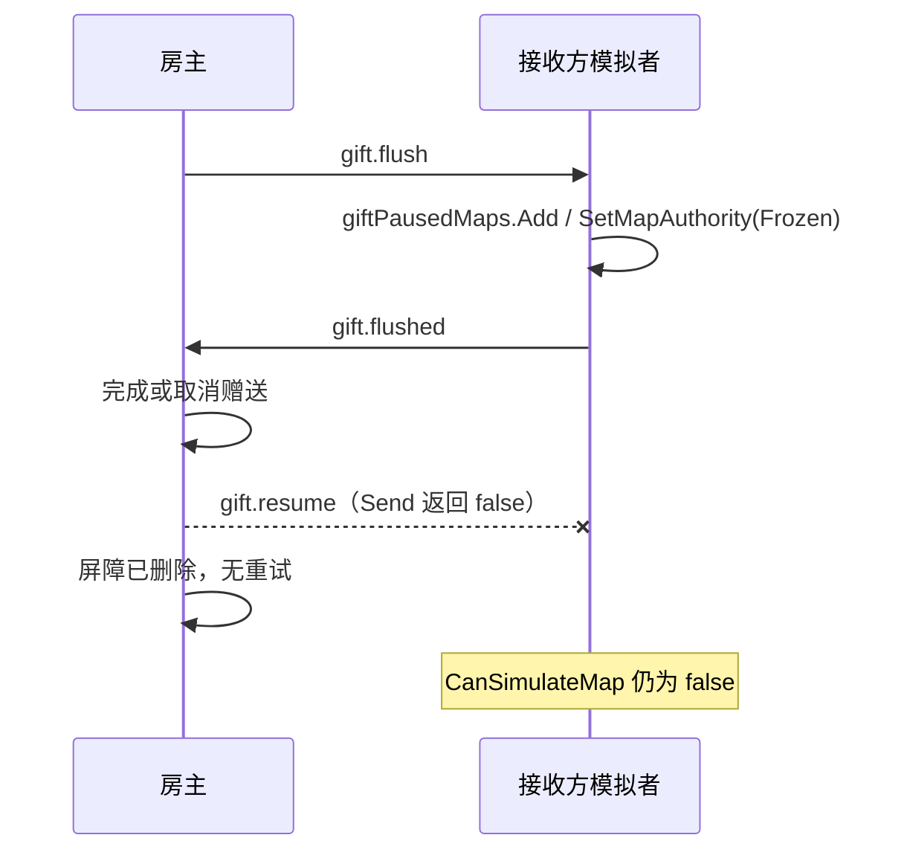

# 联机 MOD 第三轮静态 BUG 审计与 Agent 修复交接

> 日期：2026-10-17
> 唯一主仓库：`C:\Users\CatStudio\Desktop\FreeWorldMods\FreeWorldMultiplayer`
> 审计起点：`HEAD=24de760`，`VERSION=1.20`；实际分析的是含历史未提交／未跟踪文件的**工作目录快照**，并非该提交的干净源码或三端安装 DLL。
> 范围：连接与握手、身份验证、赠送地表权限收口、地图缓存超时。仅静态审查和文档交接；**未修复源码、未构建/安装、未运行游戏或网络攻击测试**。

> **并发更新：**审计记录过程中，其他 Agent 已将主仓库推进至 `85862c7`／`VERSION=1.22`（先后有 BUG-03 存档列表修复及 BUG-09 UI 同步失败反馈修复）；均未作为本轮 BUG-11～14 的实机复现证据。本报告刻意保留最初审计基准，后续 Agent 需重新核对最新源码。

## 0. 阅读说明

- 本文件只登记 **BUG-11～BUG-14**。上一轮 [BUG-01～05](联机MOD静态BUG审计与Agent修复交接-20261017.md) 和 [BUG-06～10](联机MOD第二轮静态BUG审计与Agent修复交接-20261017.md) 不重复计算。
- **代码确认**：确认源代码中存在指定分支、顺序与缺失的失败收口路径。**触发条件待复测**：通过超时／发送失败等故障注入才能证明用户现场是否能进入该分支。**安全设计风险**：可以按算法推导凭证等价性，但本轮没有实际攻击或截包。
- 优先级：P1 = 可能影响会话权威、安全或全局运行；P2 = 影响房间可用性或局部恢复。优先级不是已测发生概率。
- 修复 Agent 开始前必须阅读 `AGENTS.md`、`Agent.md`、`docs/plans/联机方案 V1.md`、`AGENT-COORDINATION.md`、`GIT-COMMIT-POLICY.md` 及角色邮箱；核对原 Owner 文件占用和后续修改，不能按本报告擅自解除冻结或覆盖其他 Agent 的未提交源码。

## 1. 本轮发现总览

| ID | 严重度 | 类别 | 源码行为与风险 | 建议负责模块 |
| --- | --- | --- | --- | --- |
| **BUG-11** | **P2** | 连接容量 | 未认证但保持连接的 peer 占用人数槽位，`hello/auth` 没有会话层超时 | Transport + Session |
| **BUG-12** | **P1** | 地表权威 | `gift.resume` 发送失败被吞掉且删除房主屏障，接收者可能永久保持冻结 | Session / Gift / Authority |
| **BUG-13** | **P1** | 身份安全 | 房主保存的 `Verifier` 直接作为登录 HMAC 密钥；TCP 初次登记明文发送，存在跨世界身份冒用风险 | Core / Credentials / Transport |
| **BUG-14** | **P1** | 全局稳定性 | 地图缓存超时通知的发送异常可能越过 `Tick`，使 Runtime 永久停止整个会话推进 | Session / Entry |

## BUG-11：未完成认证的连接没有统一超时驱逐

**静态判断：确认容量占用与缺少认证超时；TCP 自带 90 秒读超时，Steam 具体驻留时长待实测。**

**证据路径：**

- `src/Transport/TcpTransport.cs:40-45,101-112`：房主 `maxPeers=MaxPlayers-1`，`AcceptLoop` 在 `peers.Count>=maxPeers` 时拒绝新连接。添加 transport peer 发生在接收任何 `hello` 之前。
- `src/Transport/TcpTransport.cs:145-155,165-195`：`ReceiveTimeout=90000` 仅针对 socket 读；静默 TCP peer 在超时前持续占槽。周期性少量输入的更长停留需额外模拟确认。
- `src/Transport/SteamTransport.cs:52-64,131-150`：Steam P2P 在 `ConnectionChanged` 先检查 transport `peers.Count` 并入表；未发现静默 peer 的 MOD 层认证期限。
- `src/Session/Networking.cs:14-44`：`TickRejectedPeers` 只枚举已经**被拒绝**的 `rejectedPeers`，不是所有待认证连接。
- `src/Session/Networking.cs:85-91,120-145,202-209`：房主收到 transport `Connected` 不登记认证截止时间；`challenges` 仅在客户端实际发送 `hello` 后登记，且未查到会话内对“未发 `auth`”的统一过期清理。

**触发条件与影响：** 在四人以内等小房间中，若非正常客户端接通 TCP/Steam 却一直不完成 `hello/auth`，名额由 transport peer 占用。房主的 `World.Players.Online` 可能仍未满，其他真正玩家却被底层拒绝。TCP 的一次完整静默连接有 90 秒读超时，Steam 的强制清理由平台决定、源码未给出会话级上限。**不宣称 Steam 连接可以永远不超时**。

**修复方向：** 给 transport `Connected` 的未认证 peer 单独设置非暂停时间驱动的截止期（如 10～20 秒，可配置），完整 `auth/welcome` 后移出 pending。过期先回送最小错误、后执行有界 drain/Disconnect；与 `RejectUnauthenticatedPeer` 和 BUG-06 登录失败回滚合并考虑。不能以 `World.Options.MaxPlayers` 直接替换 transport 上限来掩盖未认证占位。

**验收：** 使用最小 stub client 测 ① 连接后不发 `hello`；② 发 `hello` 后不发 `auth`；③ 正常慢速但在期限内完成握手；④ Steam/TCP 混合房间。过期后 transport peer 与 `challenges` 均释放，合法玩家可加入，不踢掉已验证连接。

## BUG-12：赠送收口的恢复消息失败后不重试，地图可持续冻结

**静态判断：代码确认，后果需要故障注入验证。**

**证据路径：**

- `src/Session/PlayerGiftCheckpoint.cs:35-43`：客户端接收 `gift.flush` 时先 `giftPausedMaps.Add(mapId)`、再要求 `bridge.SetMapAuthority(Frozen)`，成功后设置 `giftFlushes[mapId]`。原生冻结失败时，`giftPausedMaps` 已增加但对应后续驱动还没登记。
- `src/Session/PlayerGiftCheckpoint.cs:67-71`：房主 `ClearGiftBarrier` 在移除 `giftBarriers[transferId]` 后调用 `TrySendCommunication(...,"gift.resume",...)`，**不检查返回值、不保留重试依据**。
- `src/Session/PlayerChat.cs:69-78`：`TrySendCommunication` 对已断开／队列满等返回 `false`；不会保证 `gift.resume` 已送达或被接收。
- `src/Session/PlayerGiftCheckpoint.cs:73-80`：只有收到 `gift.resume` 的路径才清理 `giftPausedMaps` / `giftFlushes` 并恢复原生地图权限（另有完整地图恢复时的清理）。`src/Session/Authority.cs:114-117` 中 `CanSimulateMap` 明确要求 `!giftPausedMaps.Contains(mapId)`。
- `src/Session/RaidRules.cs:110-131` 和 `src/Session/Commands.cs:328-344`：正常落仓、取消等确实调用了 `ClearGiftBarrier`，不是死代码。

**触发示例：** 客人 B 是母舰地图模拟者，收到 `gift.flush` 成功冻结 → 房主完成或取消赠送 → **房主发往 B 的传输发送队列**短时满导致 `gift.resume` 发送失败 → 房主删除屏障，不再重试 → B 仍持有 `giftPausedMaps`，继续被禁止模拟。另一条失败路径是 B 冻结原生地图时抛异常，尚未来得及登记 `giftFlushes`，此时也缺清晰恢复路径。由于重新进入完整地图会清理此标志，**不应描述为绝对无法恢复**。



**修复方向：** 将 “恢复地表权限” 设计为带 `TransferId+MapId+AuthorityEpoch` 的有界、可重试、幂等消息流程（可用 resume-ack，或与后续权威 policy/view 统一复核）；`gift.resume` 失败不能当完成。`giftPausedMaps.Add` 与 `SetMapAuthority` 原生应用失败必须有单独故障锁/安全撤销；不要在原生状态未知时简单清空暂停标记继续模拟。

**验收：** 模拟 `gift.resume` 的 `Send` 返回 `false`、延迟／重复消息、赠送取消、模拟者换人、`SetMapAuthority(Frozen)` 抛异常；能在一致的任期内恢复或明确锁定并重同步，不能永久默默冻结，也不能在赠送进行中双端同时模拟。

## BUG-13：`Verifier` 是可重用登录密钥，不是不可用于登录的验证值

**静态判断：确定性密码学设计风险；未尝试截获或冒用真实玩家。**

**证据路径：**

- `src/Core/Storage.cs:45-53`：`CryptoData.Hash(secret)` 返回 SHA256 Base64；`CryptoData.Proof(verifier, challenge)` 直接使用 `Convert.FromBase64String(verifier)` 作为 **HMAC-SHA256 的密钥**。
- `src/Session/Networking.cs:202-213`：首次登记时房主采纳 `authentication.Verifier`，既有用户直接使用 `player.CredentialHash` 计算预期 HMAC。
- `src/Session/Networking.cs:289-294`：客户端使用 `SHA256(identity.Secret)` 计算 `verifier`，且第一次登记时将该 `verifier` 发给房主。
- `src/Session/Credentials.cs:8-11,20-33`：恢复码也包含 `CredentialId + Verifier`，更说明二者构成足以进行认证的材料；这不是“只能验证、无法登录”的哈希。
- `src/Core/IdentityStore.cs:18-26,53-64`：默认身份以运行渠道与游戏安装路径划分作用域，**不以联机世界划分**；同一运行副本可在不同房主世界使用同一个 `CredentialId`。
- `src/Core/Protocol.cs:26-30` 与 `src/Transport/TcpTransport.cs:203-216`：`Protocol.Encode` 为 UTF-8 JSON，TCP `NetworkStream.Write` 直接发消息，没有应用层 TLS/加密；首次登记的 `Verifier` 可被该 TCP 路径上的可观察通信方获取。Steam 原生传输的网络加密不在本轮评估范围。

**影响边界：** 拿到某安装副本 `CredentialId + Verifier` 的一方无需知道原始 `Secret`，就能为任意新 nonce 计算当前协议认可的 `Proof`。若该 `CredentialId` 在**另一**联机世界也有绑定，其身份可被冒用：例如不可信房主读取其世界里保存的 `CredentialHash`，或网络观察者看到首次明文 TCP 注册。**这一结论是算法等价性，不是假定已经发生实际入侵。**

**修复约束：**

1. 不要把服务端持有的“验证值”直接当成客户端登录密钥；设计真正不暴露可复用凭证的验证机制（例如适合离线部署的公私钥挑战签名，客户端只存私钥，房主存公钥）。若继续保留基于共享密钥的模型，必须明确房主属于完全可信实体，并限制跨世界复用，不能把 hash 标注为非敏感。
2. TCP 是否需要 TLS、房主身份信任锚、恢复码的安全迁移要一起设计；新增协议版本与旧`SchemaVersion`兼容/升级规则不能由单个模块擅自定稿。
3. 严格保护旧凭证，不在日志或诊断文件输出 `Secret`、`Verifier`、恢复码；改造不能默默拆分已存在的 `WorldId + PlayerId`资产绑定。

**验收：** 使用全新生成的**测试凭证**在完全离线／本机模拟的两世界中验证：“只知道旧 `Verifier`”在新认证设计中**不能**产生合法登录证明；正确客户端可注册、续开和重绑。对真实线上身份不执行攻击测试，不得将凭证写入 BUG 文档。

## BUG-14：地图缓存超时的通知失败可导致整个会话 Tick 永久停止

**静态判断：异常传播链确认；发生概率待缓冲区满注入。**

**证据路径：**

- `src/Session/MapSnapshotCache.cs:55-69`：`TickMapCache` 遍历 `offeredMapViews`，60 秒超时移除记录后，若玩家连接还在，就直接 `Send(peer,"error",...)`；周围没有异常隔离或排队重试。
- `src/Session/MultiplayerSession.cs:265-279`：`Tick` 在消息主循环前直接调用 `TickMapCache(seconds)`，不在 `try/catch` 内，超时 `Send` 抛异常可以穿过 `Tick`。
- `src/Transport/TcpTransport.cs:222-232`、`src/Transport/SteamTransport.cs:155-161`：peer 发送队列拥塞／尚未就绪可能抛 `IOException`。
- `src/Entry/ModPluginLauncher.cs:76-87`：`Update` 捕获 `Session.Tick` 异常后设 `tickFailed=true`，以后每帧 `if (Session != null && !tickFailed)` 会阻止继续推进整份联机会话，直到显式退出/清理。

**触发示例：** 房主已经发 `map.cache-query`，客人 60 秒没有回复 `map.cache-offer`，但 transport peer 尚在线且发送队列已满；超时通知 `Send` 抛 `IOException` → Tick 异常 → `MultiplayerRuntime.tickFailed=true`。这不是单一客人地图同步失败，而是**房主世界的时钟、收包和自动保存 Tick 全部停止**，即使其他玩家网络正常。

**修复方向：** 将非权威的缓存“错误通知”与不可恢复的会话故障分开；每 peer 捕获 `IOException` 并执行明确隔离或断开，保留已确认的权威地图版本。终止一条缓存协商不能中止其余玩家的房主 Tick；如果核心状态确实未知，则需要显式进入“房主故障锁”，而不是由一个通知抛异常把 `Runtime`全局停掉。

**验收：** 用 transport 测试替身制造 `offeredMapViews.Elapsed>=60` 且 `Send(error)` 抛异常；确认房主 `Tick` 仍能继续对其他 peer 收包／推进；超时 peer 被清理或明确隔离；不得以忽略 `map` 权威提交、吞掉真实致命错误换取继续运行。

## 2. 交接顺序与协作边界

1. **先明确 BUG-13 的身份威胁模型**：Core + Transport + Session 主控设计评审，涉及协议与旧凭证迁移；可单独立安全改造任务，不应与一般性能优化混提交。
2. **BUG-12 与第二轮 BUG-08/10 要一起制定确认/重发约定**：同一套发送失败、ACK 与最终检查点原则可以复用，但每种业务成功条件必须清楚。
3. **BUG-14 可先由 Session 进行局部故障隔离**，同步对照第二轮 BUG-07，以免打断全房间清理与权威转移。
4. **BUG-11 由 Transport 提供 pending-peer 可观测生命周期，Session 认证成功时解除截止期**；请注意 Steam/TCP 混合房间，不能让某一种 transport 独自绕过安全边界。
5. 所有原有 Owner 尚未签收的 `Networking.cs`、`Authority.cs`、`MultiplayerSession.cs`、`GameBridge.cs`、`TcpTransport.cs` 等仅用于**只读审计**。原第十三轮发布门禁和 BUG-04 已提交窄补丁不代表这些混合文件可覆盖或允许自动三端安装。
6. 修复 Agent 对每项记录具体补丁、独立 Git commit、兼容版本变更、纯逻辑测试和三端 BuildOnly；由用户完成游戏/双端验收。没有实测不能写“修复已验证”。

## 3. 后续 Agent 修复回填模板

```text
BUG-ID：
负责人 / 文件 Owner 签收：
结论复核：成立 / 不成立（附实际证据）/ 条件性成立
重现条件、最小输入、预期和实际结果：
源码修复及独立提交哈希：
本地逻辑验证 / Steam、TapTap、Project3 编译结果：
协议、存档、身份迁移、回滚影响：
游戏内及双端用户验收：
尚未解决的阻塞与风险：
```

**本轮总结：** 共记录 4 项与前两轮不同的静态问题或设计缺陷；仅交付审计文档、Agent 协作入口，**不声称修复或运行验收通过**。
