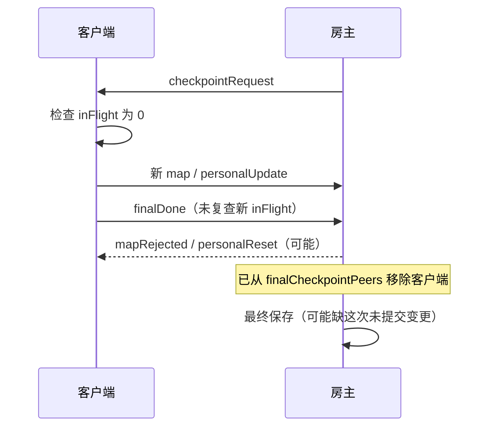

# 联机 MOD 第二轮静态 BUG 审计与 Agent 修复交接

> 日期：2026-10-17
> 仓库：`C:\Users\CatStudio\Desktop\FreeWorldMods\FreeWorldMultiplayer`
> 源码版本：`VERSION=1.19`，本轮开始时 `HEAD=0430fb6`；判断基于当时**包含未提交、未跟踪文件的实际工作区**。
> 任务性质：**只读检查业务源码，新增交接文档，不改功能代码，不构建、不安装、不运行 Unity/游戏，不做双端实测。**

> **并发变化提示：**本轮审计进行中，另一 Agent 创建了 `9e24be5` 提交，版本增至 `V1.20`，并交付第一轮 BUG-04 的前置输入校验窄补丁；该补丁只有其记录的构建/逻辑检查结果，未做游戏内验收。下列 BUG-06～10 以已读取的实际逻辑为证据，接手时务必重新核对最新源码。

本文件是 [第一轮 BUG-01～BUG-05](联机MOD静态BUG审计与Agent修复交接-20261017.md) 的**增量审计**，**不重复登记**已有问题。新增编号固定为 BUG-06～BUG-10；若接手时源码已发生改变，应先复查，不要直接套用本轮结论。

## 1. 结论与严重度

| ID | 优先级 | 静态证据 | 模块 / 影响 | 结论 |
| --- | --- | --- | --- | --- |
| **BUG-06** | P1 | 顺序与缺少回滚路径明确 | Session/Networking | 握手登记中途失败会残留 `Online=true`，同一身份重连被拒 |
| **BUG-07** | P1 | 异常路径明确 | Session/Networking + GameBridge | 客人断线清理的原生步骤失败后，访客与地图模拟权交接被跳过 |
| **BUG-08** | P1 | 广播异常到 ACK 的调用链明确 | Session/Authority + Transport | 一个接收方的队列满可能阻断另一个提交者的 ACK，持续卡住同步 |
| **BUG-09** | P2 | 返回值丢弃明确 | Entry/Session | 联机 UI 忽略同步拒绝结果，用户点击操作没有明确失败提示 |
| **BUG-10** | P1 | 检查点结束门禁次序明确 | Session/MultiplayerSession | 最后一批差量发出后未经重新核验即发 `finalDone`；房主只认完成消息 |

**证据分级：**上表确认的是源码逻辑与条件路径，并非已在游戏中触发；其中 BUG-06～08、10 的现实严重性依赖指定故障注入。P1 表示**一旦满足条件可能触及多人一致性/可恢复性**，不代表故障发生率已经测量。BUG-09 属于可直接确定的 UI 返回值遗漏，用户现象仍待现场核验。

## BUG-06｜握手半成功导致玩家被锁定为“在线”

**主责：**Session / Networking。**状态：待认领，代码确认，未注入异常。**

### 源码证据

- `src/Session/Networking.cs:202-245`：`AuthenticatePeer` 完成身份校验、首次资产生成与 `SaveOrThrow()`。
- `src/Session/Networking.cs:248-254`：依次 `player.Online = true`、`Require(bridge.SetPlayerOnline(...))`、`Broadcast("playerJoined", ...)`，最后才加入 `peers[peer]` / `playerPeers[...]` 并发送 `welcome`。
- `src/Session/Networking.cs:202-221`：后续握手遇到同一 `player.Online` 时直接拒绝。
- `src/Session/Networking.cs:410-416`：`RemovePeer` 仅在 `peers.TryGetValue(peer, ...)` 成功时才进入玩家下线流程；对尚未登记的连接直接返回。
- `src/Session/MultiplayerSession.cs:296-308`：本次 `auth` 若抛异常，会转入会话消息失败／未认证连接拒绝，但看不到对应的 `player.Online=false` 回滚。

### 触发路径

身份和存盘成功 → `Online=true` → 原生在线恢复失败（或对其他客人的 `playerJoined` 广播发送失败）→ 没有执行 peer 映射 → 未认证连接被断开时 `RemovePeer` 无法找到该玩家 → 房主内存仍认定玩家在线 → 下一次相同身份登录被 `Online` 检查拒绝。

这可能占用房间人数名额且迫使房主重开房间。即使本机启动正常，**在恢复舰队／广播异常注入场景中，源码未提供一致的在线登记回滚**。

### 修复约束

使用有明确异常边界的握手状态机：`Authenticating → NativeReady → Registered → Welcomed`；登记和 `Online` 状态必须可回滚，清理时不得撤销已经安全持久化的首次资产和 UID 号段。检查与 `RemovePeer` 的竞态，不能通过忽略 `SetPlayerOnline` 错误或重复初始化玩家绕过。

### 验收

1. 在 `SetPlayerOnline(true)` 返回失败、`playerJoined` 广播失败和 `welcome` 发送失败三个边界分别注入异常。
2. 核对 `Online`、`peers`、`playerPeers`、当前地图 `Visitors` 完整收口；原凭证能再次认证，不生成第二份母舰或雇员。
3. 原生操作**已部分生效**时使用明确锁定／回滚策略，不错误宣称所有副作用都可撤销。

## BUG-07｜断线清理抛异常会跳过地图权威交接

**主责：**Session / Networking + GameBridge。**状态：待认领，异常路径确认，实机后果待测。**

### 源码证据

- `src/Session/Networking.cs:410-420`：`RemovePeer` 先从两张连接字典移除，标记 `Online=false`，再处理通讯、舰战和 `Require(bridge.SetPlayerOnline(playerId, false), ...)`。
- `src/Session/Networking.cs:421-427`：清除 `map.Visitors`、检查 `map.SimulatorPlayerId` 并执行 `ReassignMap(map)`、移除待执行命令及 `BroadcastPolicy`，**全在前述 Require 后**。
- `src/Session/MultiplayerSession.cs:~290-313`：消息外层只记录并报告异常；未针对已执行一半的 `RemovePeer` 自动补足模拟权交接。

### 触发与影响

当客人正负责某个地块模拟，网络断开时 `SetPlayerOnline(false)` 返回失败或前面的通讯／舰战清理异常，会使 `RemovePeer` 在完成玩家的连接解绑后提前退出。`Visitors` 和 `SimulatorPlayerId` 仍指向离线玩家；其他玩家不能及时承接唯一模拟权，可能导致地图冻结、指令等待和检查点异常。**不等于正常断线一定发生**，需针对失败回执测试。

### 修复约束

隔离原生表现清理与纯会话权威状态清理；非可恢复的原生失败必须显式记录／锁定，仍保证可安全撤销的地图租约、访客与待执行命令有确定结局。按地块任期和最后确认快照重派，禁止为修复“卡住”而重新开一个独立世界或跳过资产确认。

### 验收

客人持有两张地表模拟权时断线；模拟 `SetPlayerOnline(false)`、通讯收尾、舰战收尾分别异常；确认无离线模拟者残留，命令既不被重复执行，也不被静默宣称完成。另验证重新连接后同一 `PlayerId`、原地图与库存不重复。

## BUG-08｜扇出失败阻断真正提交者 ACK

**主责：**Session / Authority + Transport。**状态：待认领，条件调用路径确认。**

### 源码证据

- `src/Session/Authority.cs:556-585`：`AcceptPersonalUpdate` 已调用原生差量、推进 `player.PersonalRevision`，随后**先** `Broadcast("personal", update, peer)` 给其他人，最后才 `Send(peer, "personalAck", update)` 给原提交者。
- `src/Session/Networking.cs:50-61`：`Broadcast` 用循环对多个 peer 直接 `transport.Send`，单次抛异常会中止循环，没有逐人隔离失败。
- `src/Transport/TcpTransport.cs:222-232`、`src/Transport/SteamTransport.cs:155-161`：发送方关闭、排队超限或尚未连接会抛异常。
- `src/Session/Authority.cs:451-459`：地图 `AcceptMapUpdate` 的提交在先、再遍历 `map.Visitors` 发送包含给模拟者的 ACK；发送早期访客失败时同样可能提前退出。
- `src/Session/Authority.cs:342-350,544-554`：客户端 `inFlightUpdates` / `personalInFlight` 非空时停止后续该类提交，直到收到 ACK、Reset 或完整重同步。

### 触发与影响

举例：客人 B 提交个人进度，房主已采纳；第三方 C 的发送队列已满，`Broadcast(personal)` 抛 `IOException`；B 的 `personalAck` **没有被调用**，B 仍等待前一事务，后续个人／地图捕获可能卡住。地图差量的访客扇出同理。

此处不意味着传输应**丢弃** C 的可靠消息。问题是**不相关客户端的传输失败不应直接打断对原提交者的权威结算确认**；失败方需要隔离、断开或可证实的有界恢复，而不是忽略权威数据。

### 修复约束

先持久化必要权威状态和提交 ID，再为原提交者建立独立的确认／重发状态；对每个接收方做安全的失败隔离与完整状态恢复。与第一轮 **BUG-01（异步命令过早成功）**、**BUG-04（地图输入前置校验）** 协调，但不要合并为“发送成功就当完成”。ACK 可丢／重复，仍需幂等。

### 验收

通过 Transport 假件使 C 的 `Send` 固定抛队列满，B 的合法个人差量和地图差量都能得到一次**房主真实提交后**的 ACK（或明确拒绝并恢复），不会无限留在 `inFlight`；未收到权威状态的 C 不能继续模拟旧版本。

## BUG-09｜房间 UI 静默吞掉 `Submit` 的同步失败

**主责：**Entry / UI。**状态：待认领，直接代码确认。**

### 源码证据

- `src/Session/Commands.cs:13-22`：`Submit` 在会话关闭、银河重同步、赠送收口等情况下直接返回 `CommandResult.Fail`，没有抛异常；这些早期返回也未触发 `CommandCompleted`。
- `src/Entry/ModPluginLauncher.cs:276-283`：`MultiplayerRuntime.Submit` 在 `Perform(Action)` 内调用 `Session.Submit(command)`，**完全丢弃返回的 `CommandResult`**。
- `src/Entry/ModPluginLauncher.cs:410-415`：`Perform` 只捕获异常，不检查 `Success`。
- `src/Entry/MultiplayerRoomPages.cs:66-70`：原生“友好／中立／敌对”关系按钮通过这个入口提交命令。

### 触发与影响

例如客户端正在 `galaxyResyncPending` 时在房间面板点击更改关系：UI 按钮成功执行回调，但 `Session.Submit` 返回失败，`Runtime.Submit` 不提示；用户以为已经提交，实际未进入房主命令队列。其他依赖这一封装的方法同样有遗漏风险。

### 修复约束

由 `Runtime.Submit` 显式处理“同步拒绝”，仅在真正失败时展示 `Error`；正确区分 `Success=true, Applied=false` 的“已排队”与最终成功，避免客户端等待回执时误报完成。不要修改原生房间协议或降低现有异常诊断准确性。

### 验收

用模拟 `CommandResult.Fail` 检查界面提示；排队结果显示“等待”，真实成功显示已确认状态；同一操作不能显示重复 Toast；房间关闭／银河重同步期间点击有明确反馈。

## BUG-10｜最终检查点消息没有等新发出的提交 ACK

**主责：**Session / MultiplayerSession + Authority。**状态：待认领，门禁顺序确认，真正丢进度待断包／拒绝注入。**

### 源码证据

- `src/Session/Networking.cs:399`：客人收到 `checkpointRequest` 后设置 `finalCheckpointRequested=true`，并立即发布一次地图。
- `src/Session/MultiplayerSession.cs:414-420`：只有进入 `if` 前检查 `inFlightUpdates.Count==0 && personalInFlight.Count==0`，随后 `PublishLocalMaps()` / `PublishPersonalUpdates()` **可能新增等待中的提交**，但不再复查，即 `Send("host","finalDone",null)` 并清掉标记。
- `src/Session/Networking.cs:155`：房主处理 `finalDone` 仅从 `finalCheckpointPeers` 删除该 peer，没有与最后一批地图版本／提交 ID 绑定。
- `src/Session/MultiplayerSession.cs:494-500,511-537`：房主等待完成集合清空或 2 秒到期后做最终保存并通知关闭。

### 触发与影响

若第二次发布真的生成新个人差量／地图差量，客户端在尚未确认房主是否拒绝它们时就发送 `finalDone`。可靠 TCP/Steam FIFO **只保证发送顺序**，不能保证此前事务一定被房主成功采纳（例如 `mapRejected` 或个人字段基准冲突）。房主即使因业务拒绝未提交，也可能已从待完成集合中移除此人。存在保存“上一权威状态”却提前宣称完成的条件窗口，**未实机复现，不应直接声称有确定丢档**。



### 修复约束

最后一次发布后必须等待每笔新增事务的最终 ACK／拒绝或显式超时，且最终完成信号应包含房主可验证的版本水位或事务集合；拒绝和超时不能被当作成功。保留“房主离开时等待有上限”的设计，但超时必须报告**未确认部分**，不能显示“已收齐最终检查点”。与 BUG-08 ACK 恢复机制联动。

### 验收

分别注入：最后一次 `PublishLocalMaps` 产生新事务、最后一次 `PublishPersonalUpdates` 产生新事务、Host `mapRejected`、Host `personalReset`、正常 ACK 和 2 秒到期。只有全部提交得到可验证确认时才报告完整保存；失败显示部分未确认并保留上一个完整存档代。实机双端分别核对退出、重进后的地图和个人资产。

## 2. 修复顺序与跨 Agent 依赖

1. **Session/Auth/Authority 共识优先：BUG-06 → BUG-07 → BUG-08 → BUG-10。** 登录、断线和最终 ACK 是同一权威生命周期的不同边界；单独改变一处顺序不得跳过另一处的可靠结算与去重。
2. **Entry 可独立修 BUG-09**，接口仅需要保留 `CommandResult` 的同步失败／排队／最终完成语义。不要把同步“排队”当最终成功。
3. **已登记的第一轮 BUG-04 窄补丁由另一 Agent 提交为 `9e24be5`，尚未游戏验收。** `src/Session/Authority.cs` 仍有历史混合差异；接手 BUG-08、10 前必须确认原 Owner 范围与交接，不得覆盖他人的未提交内容。
4. 每项先在当前仓库重核 `git status`、代码行及 `AGENT-COORDINATION.md`。未经独占协调，**不允许抢写** `Networking.cs`、`Authority.cs`、`MultiplayerSession.cs` 等混合改动文件；本轮文档创建不代表解除开发冻结。
5. 修复后逐项记录：最小变更、提交哈希、版号/协议/存档迁移影响、纯逻辑故障注入、三端正式编译、实际加载版本和用户完成的双端验收。**构建成功 ≠ 实机已修复**。

## 3. 修复 Agent 回填格式

```text
BUG-ID / 负责人 / 源码独占确认：
当前状态：未认领 / 调查中 / 已修复待验收 / 已验收
根因复核（包括证据可能不成立的情况）：
修改文件 + 本地 Git 提交：
故障注入步骤、预期、实际：
单元/逻辑检查：
P3 / Steam / TapTap BuildOnly：
安装/运行 DLL SourceRevision：
真实游戏双端验收：
剩余风险、回滚、协议及存档版本：
```

**本轮实际完成：** 对当前工作区的登录、断线、地图／个人 ACK、UI 返回值与退出检查点进行只读审计；新增五项可定位的条件故障／行为缺陷；没有修改功能源码，也没有声称测试、构建、安装或实机验证通过。
