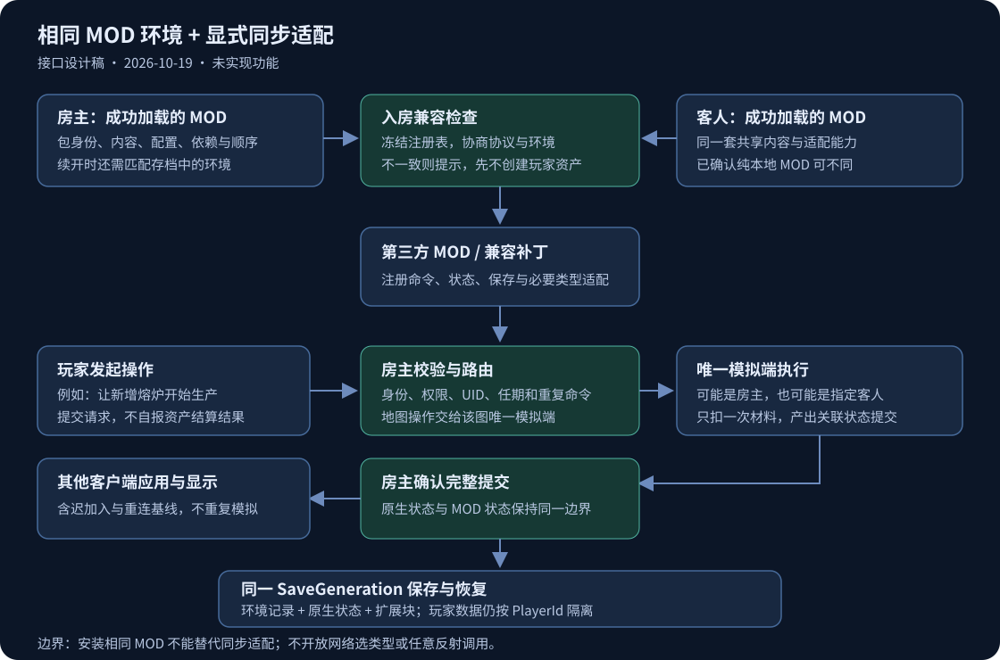

# MOD 联机兼容与扩展接口设计

日期：2026-10-19。状态：设计稿，待用户审阅；本轮仅整理方案，不实现接口、不修改协议或存档。现行玩法仍以 [联机方案 V1](联机方案%20V1.md) 为准。

## 1. 目标与适用范围

房主和客人启用同一套兼容 MOD 后，可以在共享联机世界中使用这些 MOD。联机插件负责准入、身份与权限、命令路由、同步和保存；第三方 MOD 或独立兼容补丁声明自己需要同步的行为与数据。

**相同 MOD 是环境条件，不是兼容证明。** 相同版本、相同文件也可能在两端重复扣材料、重复产出，或仅在本机改变状态。目标是提供稳定的兼容接入方式，逐个支持真实 MOD，不承诺任意单机 Harmony 补丁自动变成联机功能。

## 2. 现有能力与缺口

以下是当前工作树入口，后续实现前应复读，不能依赖本稿中的版本数字锁定并行开发状态。

| 位置 | 已有能力 | 本次设计需要补充 |
| --- | --- | --- |
| `src/Core/Protocol.cs` 的 `Hello`、`Welcome` | 身份握手和协议版本检查；本次阅读为协议 7 | 已加载 MOD 清单、兼容能力及房间环境摘要 |
| `src/Session/Networking.cs` 的 `HandleHostMessage`、`AuthenticatePeer` | 认证、绑定玩家、初始资产和欢迎消息 | 在玩家创建、UID 分配、保存及原生世界应用之前完成兼容门禁 |
| `src/Session/Commands.cs` 的 `ExecuteHostCommand`、`RouteGameplayCommand`、`ExecuteOnSimulator` | 房主接收命令，按现有权威规则路由到模拟端并确认结果 | 按 MOD 命名空间注册的命令处理器，不另建直连业务通道 |
| `src/Core/Contracts.cs` 的 `BridgeContext`、`IGameBridge` | UID、玩家归属、权限、地图模拟权及快照接口 | 对第三方暴露受限 API；这两个原生适配契约本身不是稳定 SDK |
| `src/Game/NativeWire.cs` 的 `NativeTypeBinder` | 从游戏编译类型图建立类型白名单 | 第三方类型不会因两端安装相同 MOD 就自动获准，需显式编解码适配 |
| `src/Game/NativeCommands.cs` 的 `Methods` | 原生调用白名单 | `CommandKind.Native` 不能当任意反射 RPC 使用 |
| `src/Core/Storage.cs` 的 `SaveStore` 和会话 `SaveOrThrow` | 整个世界使用同一 `SaveGeneration` 和原子提交指针 | 将兼容环境与扩展状态纳入同一完整代；当前没有通用扩展块，Load 只接受既有 SchemaVersion |
| Project3 的 `ModPluginManager`，仅作只读参考 | 扫描、启用顺序和成功安装列表 | 通过渠道适配器读取真实加载结果；Steam/TapTap 是否提供相同字段需在实现时确认 |

原生管理器是 internal，不能把它的 public 成员当作可直接引用的公开 SDK。`scanOutModList` 仅代表扫描结果，`installMods` 才记录成功加载；读取不到完整结果时应提示能力不可用，不能伪造空清单。

## 3. 采用的兼容策略

| 方案 | 优点 | 局限 | 选择 |
| --- | --- | --- | --- |
| 只比较 MOD 列表 | 成本低，可及时发现漏装 | 不能同步新增状态，不能防止重复模拟 | 必做的准入基础，不能单独交付为 MOD 联机支持 |
| 显式适配器与稳定接口 | 权威、同步、存档职责清晰；MOD 作者与兼容补丁均可接入 | 改玩法的 MOD 需要适配 | 推荐方案 |
| 自动扫描任意字段或开放任意 RPC | 看似无需作者接入 | 无法推断副作用、权限、引用关系和保存边界，维护成本高 | 不采用 |

兼容等级由已审查的适配器声明，不能只靠 MOD 作者写一个“兼容=true”绕过同步要求。

| MOD 类型 | 默认规则 | 需要的适配 |
| --- | --- | --- |
| 纯本地界面、字体、音效等，不改变规则或资产 | 经确认属于 `ClientOnly` 后允许双方不同；双方装相同也可 | 生命周期；确保不修改权威业务 |
| 新增定义、配方或平衡配置，且完全沿用已有原生行为与可序列化状态 | 双方内容、有效配置及相关加载顺序一致 | `SharedContent`；声明稳定定义 ID，确认真实状态全被原生路径覆盖 |
| 新建筑逻辑、技能、生产、任务或独立数据 | 双方环境一致，并且适配器已就绪 | `Networked`；命令、状态、持久化和权威适配 |
| 没有兼容声明的旧 MOD | 显示“联机适配未确认”，默认不作为支持组合放行 | 由独立兼容补丁补齐；不能仅因名字一样自动判安全 |

首个可用版本采用严格组合策略，不设计“忽略缺失 MOD 继续加入”的常规入口。`ClientOnly` 是已确认的豁免类别，不能由房主随意把玩法 MOD 改成此类别。

例如倍速按钮虽然属于界面，若改变模拟时间，就仍是玩法适配；不能按“只增加了按钮”归类为 ClientOnly。

## 4. 环境清单与准入流程

### 4.1 兼容描述

第三方提供独立 `multiplayer.json` 或适配器注册数据，不改造本体 XML 解析器；适配补丁用 `TargetPackageId` 指向被适配的 MOD，并记录自己独立的包身份。一个目标只能有一个有效适配器，多重认领明确报错。

| 字段 | 语义 |
| --- | --- |
| `PackageId`、`ReleaseVersion` | 原生包身份与作者声明的发布版本；保留原始 ID 规则，不按展示名匹配 |
| `Mode` | `ClientOnly`、`SharedContent`、`Networked`；未声明为 `Unknown` |
| `ApiMajor`、`NetworkSchema`、`SaveSchema` | SDK 主版本、该 MOD 的网络数据版本、保存数据版本，三者独立 |
| `ContentDigest` | 真正影响游戏的定义、资源、行为程序集和依赖的规范化摘要 |
| `GameplayConfigDigest` | 影响玩法的有效配置；排除音量、分辨率、快捷键和本地身份凭证等配置 |
| `Dependencies`、`LoadOrder` | 生效依赖及其兼容要求；比较相关 MOD 的真实相对加载顺序 |
| `AdapterId`、`AdapterVersion`、`Capabilities` | 适配器身份及命令、状态、保存、实体类型等已注册能力 |
| `RuntimeCompatibility` | 游戏渠道/本体能力与适配版本声明；不能只比较游戏名称 |

原生清单中的 `v_common` 等版本目录是游戏匹配目录，不是 MOD 发布版本。不能把所有 MOD 都显示成同一个发布版本。

默认要求相同逻辑内容和行为摘要。Project3、Steam、TapTap 分别编译可能导致 DLL 字节不同；跨渠道等价只能由明确的适配器规则和同源构建身份描述，不能仅凭同一版本号放过未知二进制差异。既有 `BUILD-INFO.json` 的来源信息可作输入，不能当第三方 MOD 通用证明。

摘要只读取声明的游戏内容，缓存于本次启动，在开房/加入前计算；不在每帧或每包扫描硬盘，不把整个 MOD 目录连同日志、缓存、UserData 一起哈希。依赖程序集若影响行为必须纳入；未知代码不能为了避免误报而随意排除。

### 4.2 加载与冻结

1. 所有 MOD 沿原生入口加载，保持全局 `ModPluginLauncher` 约定。
2. 接入 SDK 的 MOD 注册描述与实际处理器；支持联机插件先加载或后加载，不要求在本插件 launcher 内立即完成注册。注册入口不能依赖会话已经创建。
3. 原生加载完成后，开房/加入前核对成功加载清单、依赖和处理器，形成不可变注册表。缺处理器、重复 ID、加载失败均不进入 Ready。
4. 房间内冻结 MOD、玩法配置与适配器集合；发生变更必须退出房间、重新加载并重新协商。没有后台热替换或自动下载执行代码。

### 4.3 握手与世界门禁

- 房主新建前检查当前环境；续开时先从存档读取环境元数据并比较，完成后才调用原生 `LoadWorld`。
- 客人加入使用当前受限握手链交换协议/SDK版本、清单摘要及有界差异数据。大清单不能绕过既有未认证消息大小、数量和超时限制；超限明确拒绝。
- 房主先确认环境一致及适配能力，再允许认证提交后的玩家创建、UID 分配、初始资产和保存。认证与兼容检查都通过才发业务欢迎状态；客人也必须先检查房主环境再应用世界。
- 把协商结果绑定当前连接、SessionId 和本次环境摘要，重连重新检查；不能复用旧房间的“已通过”标记。
- UI 列出缺失、多装、版本/配置/顺序不一致、未适配、加载失败；提示具体 MOD 和处理方式。两端均需的包差异阻止入房，已声明 `ClientOnly` 的差异不阻止。
- 不把完整路径、UserData、凭证或配置原文发给对方。摘要用于兼容性检查，不是反作弊证明；已加载 C# MOD 本来就在本机执行，SDK 不能沙箱化任意 Harmony 补丁。

新增准入语义必须升级核心协议；旧协议不能因缺字段自动当作“无 MOD”。具体版本号由实施时的最新协议递增，不在本稿预占版本。

## 5. 最小公开接口

建议提供独立、轻量 `FreeWorldMultiplayer.Api` 契约程序集，只使用目标游戏共有的基础 C# 类型。公开签名不引用 Unity 对象、游戏 Bean、Newtonsoft 的 `JToken` 或内部 Session 类型，避免不同渠道私有 JSON 程序集引发类型冲突。SDK 主版本内保持兼容；第三方不得私带另一份契约 DLL，部署规则必须避免重复加载身份。

优先把联机适配放在可选的独立兼容补丁中，由补丁声明依赖联机插件和目标 MOD；原 MOD 保留自己的单机加载路径。不能为了接入 SDK 让未安装联机插件的单机玩家因缺契约程序集而加载失败。由原作者内置适配时也要隔离可选适配程序集与核心入口，不能只用运行时判空来掩盖 CLR 提前解析依赖的问题。

以下为候选接口合同，不是已经存在的可调用代码。DTO 字段含义在表后约定；实现时只增加真正接入调用链的接口。

| 合同 | 候选签名 | 职责 |
| --- | --- | --- |
| `IModRegistry` | `IDisposable Register(ModDescriptor descriptor, IModAdapter adapter)` | 原生加载后登记；重复失败。退出游戏释放；房间内禁止增删注册 |
| `IModAdapter` | `void Register(IModRegistrar registrar)` | 注册命令和编解码器，不在此处改变世界 |
| `IModAdapter` | `void OnSessionReady(IModContext context)` / `void OnSessionClosed()` | 首次状态恢复完成后启用功能；断线/退出清理房间引用与订阅 |
| `IModRegistrar` | `void RegisterCommand(string operation, ModCommandPolicy policy, IModCommandHandler handler)` | 完整键为 `PackageId/operation`；policy 声明世界/地图作用域、所需权限、负载上限及状态写入范围，不扩张核心 CommandKind 枚举供第三方任意编号 |
| `IModRegistrar` | `void RegisterState(string stateKey, ModStatePolicy policy, IModStateCodec codec)` | 状态键命名空间、作用域、网络/保存版本及持久化要求 |
| `IModContext` | `string Submit(ModCommandRequest request)` | 立即返回 CommandId；提交不等于执行或保存完成，结果沿异步回执通知 |
| `IModContext` | `bool CanSimulate(long mapId)` / `long AllocateEntityUid(long mapId)` | 复用当前模拟权及 UID 号段；仅查询不能代替提交时再次校验 |
| `IModContext` | `bool HasPermission(ModPermissionQuery query)` | 使用真实 PlayerId、归属与关系规则，不把“房主”当所有资产的所有人 |
| `IModContext` | 只读 `IsPaused`、`SimulationSpeed`、`WorldTimeMM` | 接入正式时钟；暂停、冻结和未就绪期间不继续结算 |
| `IModContext` | `void MarkStateDirty(string stateKey, ModScope scope)` | 仅向核心标记待捕获状态，由核心按预算、权限与提交边界收集；不立即向任意客户端发送 |
| `IModCommandHandler` | `ModValidation Validate(ModCommandContext context, string payloadJson)` | 在房主校验结构、权限、业务前置条件；无副作用 |
| `IModCommandHandler` | `ModExecution Execute(ModCommandContext context, string payloadJson)` | 仅在指定权威端执行；执行端再次核对任期与前置条件，产出可提交变更 |
| `IModStateCodec` | `string Capture(ModStateContext context)` | 捕获脱离原生对象引用的完整状态，用于首次加入、交接和保存 |
| `IModStateCodec` | `ModValidation Validate(ModStateContext context, string payloadJson)` | 在原生修改前核对版本、UID引用和范围 |
| `IModStateCodec` | `void Apply(ModStateContext context, string payloadJson)` | 只应用已确认状态；副本不得再次结算或启动模拟 |
| 可选 `IModSaveMigrator` | `string Migrate(int fromSchema, int toSchema, string payloadJson)` | 离线副本迁移；成功完成完整代后才切换存档，不在入房中静默迁移 |

`ModCommandContext` 的身份由已认证连接映射得到，包含 WorldId、SessionId、真实 ActorPlayerId、MapId、AuthorityEpoch、BaseRevision 和 CommandId；不能信任 payload 自报的操作者、归属或执行端。世界级操作由房主执行；地图级操作由该图唯一模拟端执行，房主保留提交确认。

`ModStatePolicy` 声明 `World`、`Player`、`Map` 或 `Entity` 作用域及是否持久化。键形如 `PackageId/stateKey + ScopeId`；Player 使用 PlayerId，Map 使用 MapId，Entity 使用全局 UID 并附所属地图/所有人。相同原生资产不能再以扩展状态复制一份库存。

`ModStateContext` 携带作用域、身份、任期、Revision、初始/恢复/交接阶段及 Schema；由核心构造。持久化 Capture 在同一保存屏障下读取，不能在房主缓存已落后于远端模拟者时直接采集陈旧值。

`ModExecution` 分清拒绝、已执行待确认及异常；核心给最终回执标记 Applied、Saved 和 SaveGeneration。UI 的结果监听器异常不能改变已经提交的命令结果。

SDK 的生命周期、命令与 Apply 回调均在受控主线程阶段调用；网络线程只收有界字节。退出房间释放 session 订阅，注册表本身保持到游戏退出，允许同一进程重新开房。首轮只做完整扩展块与显式脏标记，不预设通用字段差量、任意广播消息、独立网络栈或每帧全量发送。第三方持续生产等变化必须由合法模拟端标脏，核心校验提交；MarkStateDirty 不能绕过命令权限或把旁路资产写入变成合法结算。

## 6. 命令、模拟与状态的一致性

1. 客人提交“对哪一个对象执行什么操作”，不能直接提交“加了多少资产”的既定结算结果。
2. 房主校验 MOD/操作已注册、身份、权限、负载大小、实体 UID 和业务前置条件；地图命令沿现有路由交给唯一模拟端，不能要求所有装了 MOD 的客户端各执行一次。
3. 模拟端复查任期后执行；扩展状态和原生资产改动必须绑定同一个命令/地图提交。房主确认完整提交后才向观察端应用和发最终回执。
4. 重复、乱序和重试使用现有幂等语义，并补齐扩展参与的提交关联；不能因为 handler 返回 Success 就提前宣布资产已保存。现存命令事务因果绑定遗留项须先收口，不声称现有去重已提供完整崩溃保证。
5. 迟加入、重连、切图和模拟权交接发送完整基线；数据未就绪时不开放扩展行为。高频运行可在后续增加专用差量，仍需基线与 Revision 校验。
6. 模拟权迁移通过 AuthorityEpoch 关闭旧端并交付状态，新端恢复完成后才运行；地图 Frozen 或房间暂停时 MOD 的后台计时/生产也必须停止。关掉插件自身 Update 不足以约束第三方已有 Harmony 逻辑，适配器需接入真实业务入口。
7. 展示回调异常记录并隔离；执行/Apply 在部分修改后失败时不能直接重试或继续保存，应冻结对应权威流程并保留现场。已证明无副作用的拒绝才可安全反馈后继续。

例如“新增熔炉 MOD”：双方装同一内容，客人点击开工；房主检查材料与使用权限，该图模拟端扣料并开始生产；燃料与生产进度在确认提交中同步，观察端只显示。保存时进度进入同代扩展块；交接后新模拟端接续生产。不能在两端各自跑一次生产然后只同步 UI。

## 7. 第三方类型与资源

首选让适配器把自定义状态编码成稳定 DTO，使用 `PackageId/typeKey + Schema` 标识；网络端只查冻结注册表中本地已有编解码器，不根据 `$type`、程序集名或网络字符串动态加载 CLR 类型。不要解除 `NativeTypeBinder` 的现有白名单来换取“支持所有 MOD”。

如果第三方对象直接嵌入原生地图/玩家对象图，仅添加旁路扩展块仍不足：需要显式类型适配合同，在 `NativeWire` 的捕获/恢复和相关实例创建入口接线。该接入必须解决引用与实例顺序、UID、所有人、原生 Before/After 和删除清理；没有实现时将对应 MOD 标记为不支持，不能静默丢字段。

定义、资源和配方使用稳定命名空间 ID，不能用本机列表下标、文件绝对路径或 `GetInstanceID()` 作为跨机身份。首次加载、地形 SEED、地图缓存和原生对象重建都要核对内容环境；缓存键应纳入世界环境摘要与 codec 版本，不能在更换 MOD 后复用旧环境缓存。

## 8. 联机存档与升级

在 WorldState 增加保存时的共享 MOD 环境描述及扩展状态块；每块记录 PackageId、StateKey、作用域/ScopeId、Schema 和数据。体积受限，首轮直接放入既有 generation 文档，不让第三方各写独立 sidecar 后单独宣告成功。

- 玩家数据仍按 PlayerId 隔离；世界规则由房主所有，地图数据属于对应地图状态，不能把客人的扩展进度存到房主单机字段。
- 保存屏障先收齐相关模拟端的完整原生与扩展状态，再生成同一代；原子切换前任何必需块失败，都不能切换 active 指针。失败恢复使用上一完整代，不拼接不同代的扩展文件。
- 缺少必需 MOD、未知 Schema、坏数据或迁移器缺失时，阻止原生加载和覆盖保存，保留原档并说明具体包。未知块保留原样，但“保留”不代表可以跳过其业务继续玩。
- 已有无 MOD 环境记录的联机存档标记为“环境未记录”；不能把字段缺失解释成“当时没有 MOD”。实施时提供明确的旧档检查/副本升级步骤，由用户选择确认，成功前不覆盖源档。
- 升级/增删玩法 MOD 仅在退出房间后对存档副本做完整迁移，更新核心存档 SchemaVersion 及 Load 校验；不能只给 WorldState 加字段便宣称兼容旧读取器。
- 此处仅涉及独立联机存档，仍不导入单机档，不触碰其他 MOD 自身单机保存目录。

## 9. 实施顺序与交付条件

以下是依赖顺序，不代表用户已授权本轮开工，也不改变 V1 完整交付约定。

1. **环境与准入**：成功加载清单的渠道读取适配、描述文件、指纹、冻结注册表、握手与新建/续开门禁、差异提示。
2. **一个真实 MOD 的接入闭环**：以用户指定的代表性 MOD 为对象，接通受限 SDK、命令权威、完整状态基线、同代保存；涉及自定义原生类型时一并完成显式适配。示例熔炉只是说明，不替用户选定要改的 MOD。
3. **恢复与交接**：重连、迟加入、跨图、权威迁移、失败冻结、旧联机档副本升级和缓存环境隔离。
4. **按证据扩大支持范围**：形成“MOD + 版本 + 配置 + 渠道 + 适配器”的支持记录；不将所有安装相同 MOD 的组合统一标成已支持。

开发职责沿现有目录划分：Core 维护契约/环境/保存 DTO；Session 维护协商、路由、权威和事务；Game 维护原生捕获/恢复与类型适配；Entry 显示清单差异与缺失依赖。继续使用既有 Steam/TCP Transport，不增加第三方直连业务 API。

用户运行验收应覆盖：相同支持组合入房及续开；缺包/多包/版本/配置/加载顺序差异；已确认 ClientOnly 差异；新增对象的制造/运输/销毁和跨玩家权限；迟加入、重连及模拟端离开；同代保存恢复；缺必需 MOD 时不覆盖存档；同一游戏进程重复开房无订阅残留。跨 Steam/TapTap 只有完成该适配组合的运行验收才列为支持。

本轮交付为本文、配套 SVG 和导航，不进行代码、协议、SDK、存档格式、构建、安装或运行验证。
