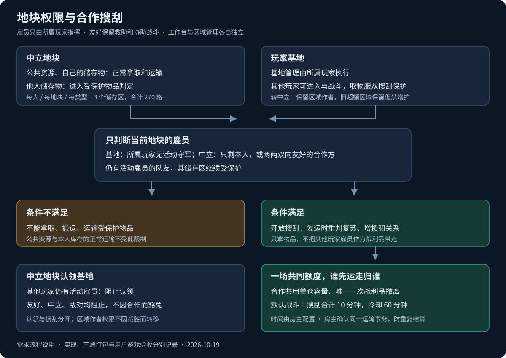

# 地块权限与合作搜刮规则

日期：2026-10-19。

本文记录本次对话中用户已确认的要求，是对 [联机方案 V1](联机方案%20V1.md) 中地块权限、友好协作和搜刮规则的后续调整。同一事项与旧方案冲突时，以本次确认的规则为准；未涉及的规则沿用原方案。

本文记录用户确认的功能需求。2026-10-19 用户已明确要求实现；源码、三端构建打包与游戏内验收分别记录，不以本文或构建成功代替游戏验收。

## 1. 地块类型与雇员控制

星球上的地块按本次讨论分为两类：中立地块、玩家基地。

- 中立地块允许不同玩家共同进入和活动。
- 基地具有明确的所属玩家。
- 玩家只能指挥自己的雇员。允许在地块发布命令，不等于获得其他玩家雇员的控制权。
- 玩家关系、基地归属、区域创建者、雇员归属分别处理；友好关系不合并这些权限。

## 2. 中立地块的区域与资源

所有玩家都可以在中立地块创建自己的储存区、种植区及发布自己的命令。

区域由创建者管理，其他玩家不能删除区域、修改其设置或取消其任务。玩家也不能取消其他玩家发布的命令。

中立地块的资源按下表处理：

| 内容 | 常规权限 |
| --- | --- |
| 公共资源，以及未处于他人储存区保护下的物品、作物产出 | 可以拿取、搬运和运输 |
| 自己储存区中的物品 | 可以正常拿取、搬运和运输 |
| 他人储存区中的物品 | 受保护，满足搜刮条件后才允许拿取、搬运和运输 |

因此，中立地块的公共资源不应整体禁止带走。公共资源和自己的储存区物品，也不需要等其他玩家雇员倒地后才能运输。

## 3. 中立地块的储存区上限

按“每位玩家 × 每块中立地块 × 每种储存区类型”分别统计：

- 同类型储存区最多 3 个。
- 同类型所有储存区的格子数合计最多 270 格。
- 270 格是该类型所有储存区的总和，不是每个储存区各有 270 格。
- 不同玩家、不同中立地块、不同储存区类型分别计算。

例如，A 在中立地块甲创建同类型的三个储存区，分别为 100、100、70 格，达到数量和格子上限；不能再新增第四个，也不能把总格子数扩到 270 格以上。A 在地块乙的配额，以及 B 在地块甲的配额，独立计算。

## 4. 基地权限

基地所属玩家可以创建、管理基地内的储存区、种植区，并发布基地生产管理命令。其他玩家不获得这些管理权限。

其他玩家可以进入基地、采集、收割、拆除、攻击；涉及物品拿取、搬运和运输时，同时受下述搜刮保护约束。不能把“允许进入或攻击”解释为“随时可以搬空基地”。

搜刮基地时，只统计当前地块内基地拥有者的雇员：

- 基地拥有者仍有雇员能够活动：不能拿取、搬运或运输受保护物品。
- 基地拥有者在当前地块内的雇员全部倒地、失去活动能力：满足搜刮条件。
- 当前地块没有基地拥有者的雇员驻守：直接满足搜刮条件。

例如，A 空投战斗雇员到 B 的基地，须先击倒当前基地内所有仍能活动的 B 雇员，才可以搜刮受保护物品。这里应击倒的是 B 的雇员，不是 A 的雇员。

## 5. 友好关系与合作范围

友好雇员之间不再相互协助工作，不因友好关系参与对方的生产、建造、搬运等工作任务。

工作台按所属玩家独立使用：A 的工作台只能由 A 的雇员使用，友好关系不开放使用权。生产选材仍需遵守储存区物品保护。

保留以下合作：

- 救助对方雇员。
- 协助对方战斗。

单向友好可以用于救助和协助战斗，但不提供共同搜刮资格。

共同搜刮要求参与玩家两两双向友好。关系不能传递：A 与 B 双向友好、B 与 C 双向友好，不等于 A 与 C 双向友好；如果 A、C 不满足条件，三人不能一起作为共同搜刮方。

## 6. 中立地块的搜刮条件

中立地块中，他人储存区的物品默认受保护。单人或友好玩家共同搜刮，按当前地块内的雇员状态判断：

- 单人搜刮：除该玩家外，其他玩家的雇员全部倒地、失去活动能力。
- 合作搜刮：当前仍有可活动雇员的玩家之间必须两两双向友好；合作方之外的其他玩家，已没有可活动雇员。
- 无人驻守时，直接满足搜刮条件。

这里的“只剩一个玩家”按玩家归属判断，不是只允许剩下一个雇员。同一玩家可以有多个雇员仍能活动。

**合作只共享对被击败者的搜刮权限。仍有活动雇员的队友，其储存区继续受保护。** 友好玩家正常在同一地块活动时，不能因为满足友好关系就互相开放储存区物品。

例如，A、B 双向友好，C 与合作方不满足共同搜刮条件。A、B 在中立地块击倒所有仍能活动的 C 雇员后，可以共同搜刮 C 储存区的物品；A、B 各自仍有活动雇员时，不能因此搜刮对方的储存区。如果 C 仍有活动雇员，A、B 不能提前搜刮 C 的储存区。

## 7. 取物、运输与人员边界

- 未满足搜刮条件时，受保护物品不能拿取、搬运或运输；不能先装进背包，再按普通随身物品运走。
- 满足条件后，只开放相应物品的搜刮权限，不获得区域管理权，不获得对方雇员控制权，也不恢复协助工作。
- 只统计当前地块内的雇员，不把其他地块的雇员算作本地守军。
- 运输实际执行时重新判断条件；期间有人被救起或有增援到场，导致条件不再满足时，重新限制相应运输，不能沿用先前获得的搜刮资格。
- 搜刮只能拿物品，不能把他人的雇员作为战利品运输带走，包括倒地雇员。救助不等于获得运输带走该雇员的权限。

## 8. 基地转为中立地块

基地可以转为中立地块。转换后，使用中立地块的权限、资源保护和搜刮规则。

- 原有区域及其创建者归属保留，不因地块变为中立而变成其他玩家可管理的公共区域。
- 原有储存区如果超过对应玩家、对应类型的数量或格子上限，保留已有区域。
- 超限时禁止新增和扩建，直到对应统计恢复到上限内；不强制删除已有区域来凑配额。
- 原储存区中的物品转换后按中立地块的储存区保护规则处理。

## 9. 中立地块建立基地

- 多个玩家正在同一中立地块建设、活动时，任何一方都不能直接认领为自己的基地。
- 只统计当前地块内的雇员。存在其他玩家仍能活动的雇员时，阻止建立基地；友好、中立、敌对一视同仁，友好关系不提供认领豁免。
- 清除其他玩家仍能活动的雇员后，才可以按正常基地创建规则认领；原有基地数量上限仍有效。
- 合作搜刮资格不等于共同占地资格：友方仍能活动时，也会阻止另一方直接建立基地。
- 击倒其他玩家不授予其区域管理权，区域及任务的创建者权限继续独立处理。

## 10. 合作搜刮额度与物资归属

- 合作方共用本场原有单空投仓容量及唯一一次战利品撤离机会，不按玩家人数增加容量或撤离次数。
- 谁先成功完成战利品运输，运走的物品就归谁，不另做平均分配或自动共享。
- “抢到”以房主确认成功的实际运输事务为准。点击、选择物品或请求排队不代表已经获得物品，其他请求不能重复扣取同一库存或重复使用本场额度。
- 合作不授予运输其他玩家雇员的权利；各玩家仍只能控制和运输自己的雇员。
- 中立地块的公共资源、自己的储存区物品正常运输，不消耗针对受保护财物的搜刮额度。

## 11. 离线保护与房主时间配置

- 中立地块上的离线玩家雇员被攻击，同样享受离线守军倒地保护；沿用原方案的本场致死转倒地，不因无人在线防守而永久删除雇员。
- 默认袭击总时限为 10 分钟：**战斗加搜刮合计 10 分钟**。击倒守军后不重置、不另加 10 分钟；合作方、增援、重连也不另开时限。
- 默认同一被袭地块冷却为 60 分钟，对进攻方共同生效；不能换一个合作玩家绕过冷却。
- 袭击总时限和袭击冷却允许房主配置，沿用现有全局默认设置及新建世界规则的保存方式；续开使用该世界已保存的配置。
- 时间沿用房间有效现实时间：不受倍速影响，房主暂停时停表；房间关闭后停止，续开不重置已保存的计时或冷却。
- 公共资源正常运输不属于搜刮，不因为本条而整体受袭击时限或冷却限制。

## 12. 未纳入本次要求的内容

前面讨论中曾提出“拆除或攻击导致物品飞出储存区”的假设，但没有确认游戏存在这种机制，该建议已撤回。本次不据此增加物品掉落保护或来源追踪要求。

地表主动赠送的额外入口尚未确认，本次沿用已有母舰赠送渠道，不因友好关系自动开放他人受保护库存。

本文只记录上述已确认规则，不自行追加俘虏、区域接管、共同劳动、第三方 MOD 兼容框架或其他新系统。
