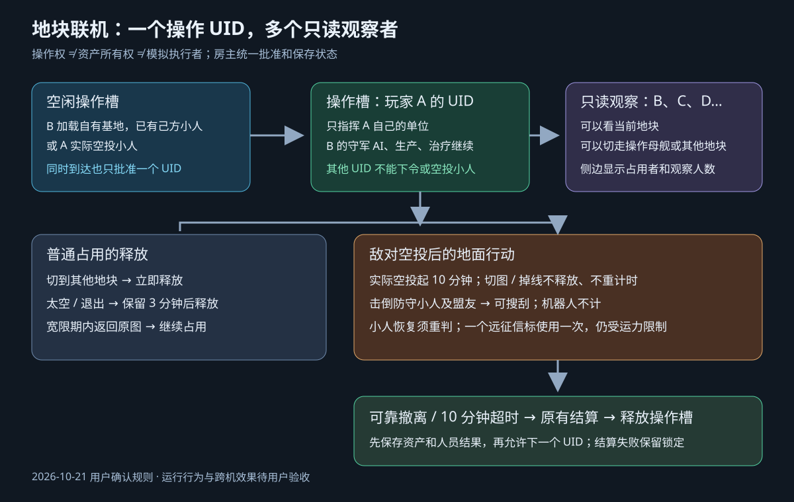

# 地块独占操作规则（2026-10-21）

本文件记录用户本次确认并已授权实现的地面联机重构。与 V1 及 2026-10-19 地块规则冲突的同图多人操作、防守方上线接管、多人共同搜刮规则，以本文件为准。未涉及的所有权、运输容量、AI、保护、超时结算及冷却规则沿用既有实现。

## 核心约束

- 每地块最多一个操作 UID，可以有多个只读观察者。操作权、资产所有权、地图模拟者分别记录；房主身份不绕过操作权。
- 当前操作玩家只能指挥自己的单位，不能因占用地块而控制基地所有者的小人或取得其资产所有权。
- 地块侧边 UI 显示操作槽空闲/被谁占用，以及当前观察人数。观察者离开该图即不计数，操作玩家不计作只读观察者。
- 偷袭是空投、击倒守军、搜刮这一流程的统称，不新增“偷袭”操作按钮。

## 获取与释放

| 场景 | 操作槽处理 |
| --- | --- |
| 基地所有者加载自己基地，且已有自己的小人 | 槽位空闲则直接取得；被别人占用则只读观察 |
| 普通占用者切换到其他地块 | 立即释放原地块 |
| 普通占用者进入太空或退出游戏 | 保留 180 秒，随后卸载并释放；返回原图取消等待 |
| 从外部实际空投小人 | 房主在实际落地事务中取得空槽；不在打开配置、出发途中占槽 |
| 其他 UID 已占用时试图空投小人 | 不允许落人；保留原运输单的等待/取消流程，不重复扣款或生成载体 |
| 只侦查或赠送物资 | 不取得操作槽，不允许绕过赠送与资产权限 |
| 敌对地面行动已经开始 | 原操作 UID 保留至行动结算；切图、太空和掉线都不提前释放 |

基地所有者是否在线不是偷袭条件。关键是操作槽是否空闲；所有者在其他地块或太空/退出宽限期届满后，可以被敌对玩家实际空投进入。

## 行动与搜刮

- 实际空投小人开始本次 600 秒行动计时。掉线、重连和切图不重新开始计时；掉线占槽时间就是本次行动尚余时间。房主暂停等既有计时规则沿用。
- 地块所有者在被占用期间只能观察该图，仍可退出观察、操作母舰或其他地块。回来不能抢走操作槽。
- 留守小人、炮塔的 AI 防御、生产、治疗等自动行为继续，不因所有者只读而停用。
- 搜刮前必须击倒全部防守小人及其盟友；机器人不计入这一门槛。小人恢复后须重新击倒，不缓存永久胜利资格。
- 获得搜刮资格不代表无限运力，沿用实际出征运输载体容量及可靠资产结算。
- 用户进一步确认“远征信标”指一次原版远征撤人操作，不是某种具体信标物品。携带人员但不带战利品也消耗机会，不能通过第二次原版运输或重复提交获得第二次撤人；普通物资赠送不因此改称撤离。
- 600 秒到期沿用原有超时结算：未可靠撤离的战利品留在地块，存活进攻人员空手返回，伤势和损失保留。结算成功后才释放操作槽；结算失败不得让下一人进入未结清地图。

## 交付边界

仅修改 FreeWorldMultiplayer 主仓库，Project3 与游戏本体只读。默认分别构建 Project3 / Steam / TapTap 三端包，不安装、不覆盖运行副本。运行与跨机验收由用户执行。

