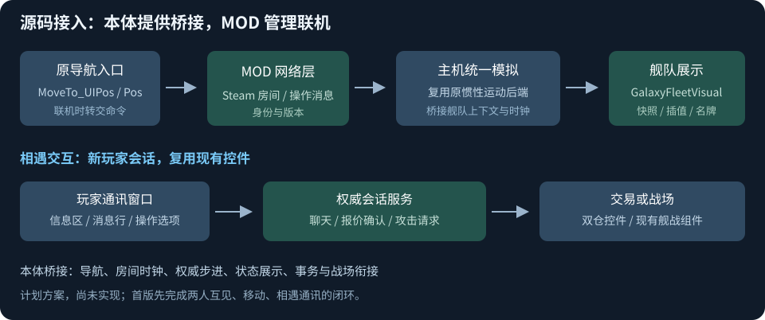

# 联机 MOD 实现方案

> **历史参考，已由 [联机方案 V1](联机方案%20V1.md) 取代（2026-10-15）。** 下文保留早期设想与源码线索；其中本体适配、交易、玩家舰战和分期交付安排不作为当前要求。现行范围为完整 V1 一次性交付，尚未获正式开工指令。

> 2026-10-14｜下面的模块与接口均为计划新增，尚未编写游戏代码。

**推荐本体开放稳定适配接口，FreeWorldMultiplayer 实现网络与玩家交互。先做一个星系、两位玩家的完整闭环。**

## 具体拆分

| 计划模块 | 做什么 | 接现有源码哪里 |
| --- | --- | --- |
| `NetworkRuntime / SteamTransport` | 原生 MOD 启动常驻组件；房间、连接、收发与断线清理 | `BaseModLauncher.launcher`、现有 Steamworks.NET；复用 SteamManager，不重复初始化 Steam |
| `GalaxyRoomHost` | 持有房间时钟、玩家/舰队注册表，校验并执行操作 | 通过适配接口复用 `FWVoyage` 与 `GalaxyFleetInertialMotionBackend` |
| `NativeFleetBridge` | 将导航、模拟和状态应用接入网络；防止本地与主机重复推进 | `MoveTo_UIPos/MoveTo_Pos`、`TickLocalMotion`、航程完成与耗油入口 |
| `NetworkFleetView` | 展示自己和其他玩家的权威状态、插值、名牌和点击目标 | `GalaxyFleetVisual.SyncFleet/ApplyPresentation/SetNameplate` |
| `PlayerInteractionSession` | 通讯消息、交易报价及攻击请求共用会话身份 | 新玩家窗口复用既有太空信息/对白/双仓控件 |
| `PlayerBattleBridge`（后续） | 创建 A/B 战场、登记 C、按玩家分配控制权和结果 | `BattleParticipant`、现有部署/舰战与结果链 |

## 移动怎么接

`点击目标 → 导航入口转交网络命令 → 主机验证玩家与舰队 → 原运动后端步进 → 广播状态 → 所有客户端展示`

- 本体适配层要接受明确的舰队上下文、星系环境和房间时钟，减少“当前玩家/当前画面”的依赖。不重写惯性移动算法，也不关闭整个 NPC 管理器。
- 网络拥有的舰队只由房间权威推进；原本的玩家运动循环不再重复写它的位置。客户端的自己舰队同样消费权威状态。
- 入房间发送星系布局、舰队外观与完整状态；随后传位置、速度、朝向、航程和状态版本。导航命令、聊天、交易走可靠消息；连续位置更新可以使用带序号的非可靠消息。
- 网络 ID 与原存档 UID 分开；玩家身份绑定已认证的连接。收到旧版本状态丢弃，重连重新建立完整快照基线。
- 房间循环独立于星系画面与个人暂停；宿主进入战斗后仍需推进其他玩家。首版宿主离开则结束房间，暂不做主机迁移。

## 交互 UI 怎么接

- 新建 `PlayerContactWindow : BaseMonoDialog`，复用舰队信息、选项区和消息行。真人消息用纯文本绑定，不调用 NPC 任务对白解析，也不获取会暂停全局游戏的 NPC Scope。
- 新建 `PlayerTradePage`，复用两个 `UI_InventoryPanel`，通过 `IInventoryMediator` 接收拖放与数量操作。对方库存使用独立展示副本。
- 拖放只编辑本方报价。每次报价变化提升版本并清除旧确认；双方确认同一版本后，权威端一起校验、一起提交两边交换，并记录唯一交易 ID。不能连续做两次单向转移来冒充一次完整交易。
- “攻击”按钮发送目标舰队 ID；权威端确认距离、保护规则与参战状态，再创建战场。关闭通讯窗口不代表同意交易，也不代表完成战斗。

## 源码决定的接入边界

- [现有运动调度:92](C:/Users/CatStudio/Desktop/Project3/Assets/Script/FreeWorldAirShip/Galaxy/GalaxyNPCFleet/GalaxyNPCFleetManager.cs:92) 只取当前玩家舰队，使用本地时间；多人需要房间调度，不能直接多挂几个原玩家组件。
- [运动后端:9](C:/Users/CatStudio/Desktop/Project3/Assets/Script/FreeWorldAirShip/Galaxy/GalaxyNPCFleet/Modules/GalaxyFleetInertialMotionBackend.cs:9) 已提供 `Reset/BeginStep/Submit/Step/Feedback`，可以复用。
- [双仓控件:110](C:/Users/CatStudio/Desktop/Project3/Assets/Script/GalaxyBattle/UI/Page_Inventory/UI_InventoryPanel.cs:110) 能注入 mediator；[原交易结账:347](C:/Users/CatStudio/Desktop/Project3/Assets/Script/GalaxyBattle/UI/PageFleetEditor/ChangeSpace/PageTradeInventory.cs:347) 却强制商店 Handler，因此复用控件，另写玩家交易页。
- [物品 UI 身份:86](C:/Users/CatStudio/Desktop/Project3/Assets/Script/GalaxyBattle/UI/Page_Inventory/StorageDataModels.cs:86) 是临时生成的；交易协议必须使用真正物资 UID 与玩家归属。

## 首版与前置条件

**先交付：创建/加入房间、互见舰队、各自导航、相遇通讯、退出恢复。** 参战舰队先使用房间副本，不写永久损失；随后接交易、双人舰战、第三方支援和地表攻防。

地表地图、雇员控制与离线防守的具体接入见：[地表联机方案](地表联机方案.md)。

实现前先核对 Steam 实际程序集与适配接口。当前读取的 `Player.log` 有 Harmony 因缺少 `AssemblyName.get_ProcessorArchitecture()` 而初始化失败的记录，[本地故障文档](C:/Users/CatStudio/Desktop/FreeWorldMods/FreeWorldSpeedControl/docs/steam-load-failure.md) 也记录了更多缺失方法；不能把纯 Harmony 补丁路线当成已确认可用。此轮没有修改本体、依赖或游戏安装文件。

消息通道参考：[Steam NetworkingSockets](https://partner.steamgames.com/doc/api/ISteamNetworkingSockets)。构建保留接口参考：[Unity 2022.3 托管代码裁剪](https://docs.unity3d.com/2022.3/Documentation/Manual/ManagedCodeStripping.html)。未运行编译、游戏或联机测试。
