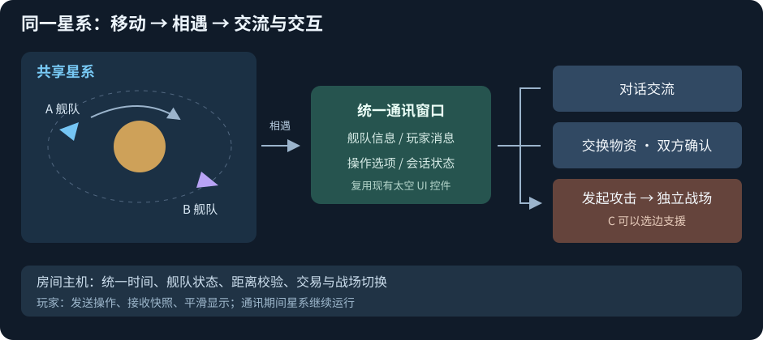

# 联机 MOD 开发构想

> **历史参考，已由 [联机方案 V1](联机方案%20V1.md) 取代（2026-10-15）。** 下文保留早期构想；冲突处以 V1 的独立玩家资产、仅 MOD 边界及完整一次性交付要求为准，旧分期路线不再执行。

> 2026-10-14｜暂定目录名 FreeWorldMultiplayer；依据 Project3 源码评估，尚未实现。

具体源码接入与模块拆分见：[实现方案](实现方案.md)；地表分支见：[地表联机方案](地表联机方案.md)。

**首要目标：玩家进入同一个星系，看见彼此舰队、各自移动；相遇后通过统一通讯窗口交流、交换物资或发起攻击。**

**推荐实现路线：本体开放小型适配接口，外部 MOD 管理房间、消息与玩家会话。** 现有航行、惯性运动和舰战规则继续复用；适配层解决当前玩家、房间时钟、控制归属与结算的接入问题。

## 玩法范围

- **星系活动**：共用星系布局与坐标，显示玩家、舰队名和移动状态；点击对方舰队可接近并发起交互。
- **太空战斗**：A 攻击 B 后创建独立战场；C 可选择支援 A 或 B，各自控制自己的舰船。建议先支持开战前选边，再做中途加入。
- **地表攻防**：B 离线时用基地快照与 AI 防守、保存战报；B 在线时双方控制自己的雇员。作为后续阶段。

## 同星系如何同步

1. **房间主机统一管理**：MOD 的 `NetworkRuntime/SteamTransport` 通过 Steam Lobby＋NetworkingSockets 连接玩家；`GalaxyRoomHost` 提供星系布局、统一时钟和舰队注册表。以上模块均待开发。
2. **接管导航入口**：在 `MoveTo_UIPos/MoveTo_Pos` 转交移动命令，由 `NativeFleetBridge` 检查控制归属，接入现有 `FWVoyage` 与 `GalaxyFleetInertialMotionBackend`。网络舰队只由主机推进，避免本地重复模拟；不关闭整个 NPC 管理器。
3. **同步状态、复用表现**：广播位置、朝向、速度、目标与状态版本；`NetworkFleetView` 复用 `GalaxyFleetVisual` 船体和名牌，并插值显示。自己和远端舰队都消费权威状态，不在客户端重复耗油或提交结果。网络舰队 ID 保留原玩家与原 UID 映射。
4. **进入与退出**：入房间先收完整快照，之后收带版本的更新；重连重新建立快照基线。个人暂停、开窗或切入战斗不停止共享星系；首版宿主离开则结束房间。

## 相遇后的统一通讯窗口

| 操作 | 建议流程 |
| --- | --- |
| 对话交流 | 发出通讯邀请 → 对方接受 → 自由文字与快捷选项 |
| 交换物资 | 双方选择货物 → 确认同一报价版本 → 主机一次性交换；修改报价需重新确认 |
| 发起攻击 | 主机校验距离与 PvP 规则 → 锁定参战舰队 → 创建战场 → 战后恢复星系状态 |

通讯不暂停共享星系。交易要检查库存与距离，取消/掉线释放占用；攻击不自动等同于双方同意，保护规则仍需确定。正式资源损失需要服务器管理参战资产与可信结算。

## 太空交互 UI 能否复用

**可以复用展示与控件，需要更换玩家数据源和执行逻辑。**

- 舰队船体、名牌与接近交互已有；目前“其他玩家舰队”加载处尚未实现。
- 新建 `PlayerContactWindow`，复用 NPC 信息面板的舰队介绍、选项区、对白头像与消息行；真人消息按纯文本显示，使用独立玩家会话，不调用 NPC 任务对白或全局暂停。
- 新建 `PlayerTradePage`，复用两个 `UI_InventoryPanel` 与 mediator 接口。拖放只修改报价草稿，双方确认同一版本后整体提交；原商店页面的税费与本地结账逻辑不接入玩家交换。

源码入口：[舰队加载](C:/Users/CatStudio/Desktop/Project3/Assets/Script/FreeWorldAirShip/Galaxy/3dstar/Fleet/GalaxyScenePlayerFleetManager.cs:177)、[运动后端接入](C:/Users/CatStudio/Desktop/Project3/Assets/Script/FreeWorldAirShip/Galaxy/3dstar/Fleet/GalaxyPlayerFleetMotion.cs:120)、[NPC 信息面板](C:/Users/CatStudio/Desktop/Project3/Assets/Script/FairyZGame/FairyUI/ViewExpeditionInfos/ExpeditionInfo_GalaxyNPC.cs:125)、[交互暂停](C:/Users/CatStudio/Desktop/Project3/Assets/Script/FreeWorldUI/Page/Galaxy/EventsDialog/GalaxyNpcInteractionScope.cs:55)、[双仓交易](C:/Users/CatStudio/Desktop/Project3/Assets/Script/GalaxyBattle/UI/PageFleetEditor/ChangeSpace/PageTradeInventory.cs:64)。

## 实现顺序与难度

**互见与移动 → 通讯 → 物资交换 → 双人舰战 → 第三方支援 → 地表攻防。**

**首版范围：两位玩家、固定一个星系，完成创建/加入房间、互见舰队、各自导航、相遇通讯和退出恢复。** 舰队先使用房间副本，不产生永久损失；NPC 与设施经营的共享规则后续再定。

互见移动原型中等难度；真实交互中高；多人实时战斗与永久损失结算高。本体适配接口需要后续实现，纯 MOD 补丁路线另需确认发行版与 Harmony 兼容性；本轮仅记录设计。

网络参考：[Steam 房间](https://partner.steamgames.com/doc/features/multiplayer/matchmaking)、[Steam 网络](https://partner.steamgames.com/doc/features/multiplayer/networking)。以上为设计建议，未运行游戏、编译或联机验收。
