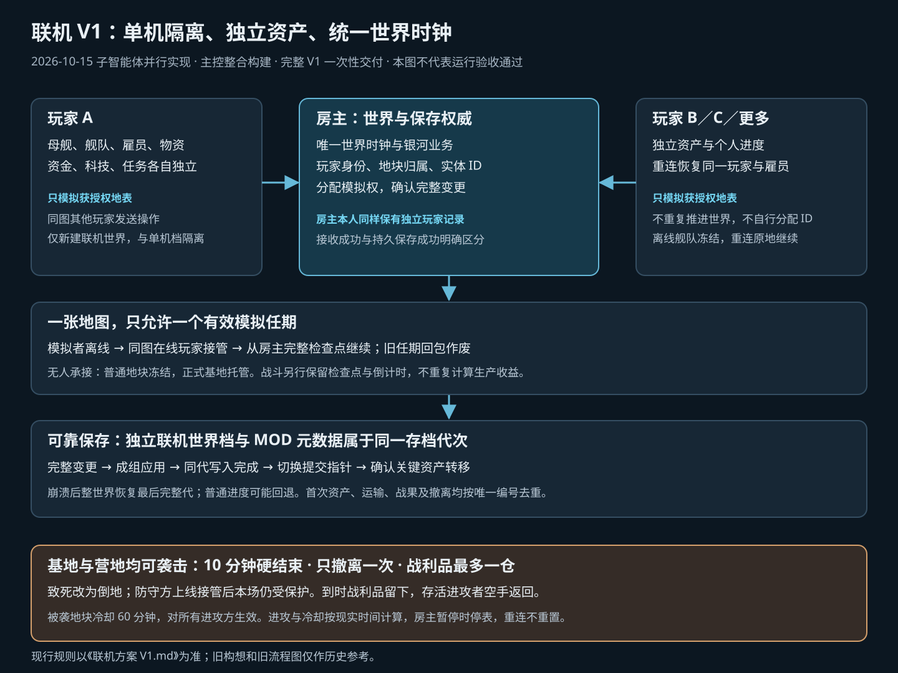

# 联机方案 V1（完整需求与实施约定）

> 2026-10-15 更新。依据用户确认整理；**V1 代码整合、P3 引用编译打包及本地 MOD 安装已完成，游戏内与跨机验收未执行**。源码在独立 `FreeWorldMultiplayer` 工作区开发；按后续指令安装到 `Project3/mods/FreeWorldMultiplayer`，Steam 更新后再迁移。只有该 MOD 安装目录允许写入，Project3 源码、资源及工程设置继续只读。实际入口与证据见 [整合与安装记录](../reports/整合与安装记录.md)。下方勾选框保留为运行验收清单，不以编译代替未执行的验收。

## 零、开工与交付边界

- **2026-10-21 地面独占操作重构**：按用户确认的 [地块独占操作规则](地块独占操作规则-20261021.md) 实现，每地块最多一个操作 UID、多名只读观察者。此追加覆盖旧同图多人发令、防守方上线接管和多人共同搜刮规则；普通占用切图立即释放、太空或退出 3 分钟释放，敌对空投开始的 10 分钟行动必须先结算再释放。操作权与资产归属、模拟执行者分开，基地 AI 继续。

- **本文是 V1 唯一现行依据**。同目录早期构想、实现方案、源码评估和旧流程图仅保留作历史参考；冲突时以本文为准，不能按旧文档增加交易、玩家舰战或本体适配开发。
- **2026-10-19 地块权限追加要求**：按用户确认的 [地块权限与合作搜刮规则](地块权限与合作搜刮规则-20261019.md) 实现。该文对旧的友好共同劳动、背包默认赠送、基地废弃及搜刮参与者规则作后续调整；同一事项以追加要求为准。包括中立储存配额、工作台专属、所有其他玩家阻止认领、两两双向友好共同搜刮且共用唯一运输额度、可配置的战斗加搜刮总时限与冷却。地表额外赠送入口、第三方 MOD 兼容框架不在本次范围。
- **已授权开始实现**。用户于 2026-10-15 明确授权按新保留范围继续 MOD 开发与构建，并要求主代理仅主控、协调和整合，实际功能由子智能体实现。Project3 始终只读。旧 Steam DLL 依赖缺口与开发实现分开记录，不能把仓库、检查工具或部分代码视为完整 V1。
- **完整 V1 一次性交付**。本文全部功能属于同一交付范围，不以原型或部分功能替代，不改成分期交付。
- Steam 发行版接入、Harmony 兼容性及无 Steam 启动仍是技术待确认项。发现纯 MOD 路线存在实际缺口时须明确说明，不能擅自修改本体、替换本体运行库、删减功能或宣称已解决。

## 一、联机与房主存档

- [ ] **联机与单机隔离**：只支持新建联机世界开局，以及之后读取该联机世界的存档继续开房；不导入或转换已有单机存档。联机存档及对应 MOD 元数据使用独立目录和存档列表，不读写单机存档；进入、退出联机或保存失败都不能覆盖、串用单机存档。
- [ ] **世界与资产**：A 开房，B 首次进入时在 **A 的世界**生成自己的母舰、雇员与初始物资，不导入 B 的单机存档。**每位玩家的母舰、舰队、雇员、基地、物资、资金、科技和任务分别独立**，不会因为进入同一房间而合并。共享的是世界空间、地块占用、世界时间和银河业务；玩家之间的赠送、协作与袭击按本文规则发生。所有玩家数据统一由房主保存。
- [ ] **重连**：B 再次进入同一世界，恢复原母舰、舰队、雇员、基地、资源和位置，不重复领取初始资产。
- [ ] **连接**：Steam 好友邀请优先，也支持房间号；另外提供 **IP＋端口直连**及房主端口配置。直连模式的目标是**完全不启动 Steam 也能连接**；实际能否脱离 Steam 启动游戏、加载 MOD，仍需验证。
- [ ] **玩家身份**：资产使用稳定的 `WorldId + PlayerId` 标识，不使用昵称、IP 或临时连接号识别玩家。IP 直连使用首次生成并本机保存的独立随机身份凭证，房主核验后绑定世界内玩家记录，不依赖 Steam；Steam 身份可作为同一玩家的另一登录绑定。不同连接方式不按同名自动合并资产，跨方式绑定或凭证丢失后的恢复由房主显式处理。同一玩家同时仅允许一个有效连接。
- [ ] **房间控制**：人数上限由房主配置，希望支持 3～4 人乃至更多；只有房主控制暂停和倍速。房主退出，所有客人离开。
- [ ] **玩家离线**：客人离线后，母舰与太空舰队暂时从画面中消失，并**原地冻结**；保存当前位置、航程、状态和燃料，不继续航行、到站或消耗航行燃料。重连从冻结状态继续，不补算离线期间的舰队路程和耗油。其地表建筑和雇员保留，仍按地块实时模拟、托管或冻结规则处理。

## 二、星球、基地与模拟

- [ ] **母舰开局**：每位玩家各有母舰，分别选择星球和地块发育。
- [ ] **占地**：同一地块不可被不同玩家重复占领。每人可占领多个地块并建造、采矿、生产，但**只有一个正式基地**，只有它享受离线收益结算。
- [ ] **统一世界权威**：房主唯一推进世界时间与银河业务，包括银河事件、运输和相关结算；离线玩家的母舰与太空舰队须从航行推进中排除，不能因世界时间继续而补走航程。客户端只能模拟获授权地表，不能通过原版地表循环再次推进整份世界。全局实体 ID 由房主分配，可预分配互不重叠的号段；客户端不得各自延续同一份原版 UID 计数器。
- [ ] **在线模拟分摊**：不同玩家优先由各自电脑模拟自己的地表，房主接收完整变动并保存。**同一地块只由一台电脑执行真实模拟**：例如 A、B 都在 A 的基地，由 A 模拟，B 发送操作指令、接收结果并展示。模拟者离线时，该图其他在线玩家可以承接；接管必须从房主确认的完整状态继续，不能新建一份地图独立演算。
- [ ] **离线托管**：正式基地无人承接实时模拟时，由房主按原版离线收益思路计算产出与消耗，不持续运行其整张地表地图。基地所有者离线但同图仍有在线玩家承接时，继续实时模拟，不能同时补离线收益。
- [ ] **普通地块**：非正式基地的采矿、生产地块无人承接时立即冻结，不结算离线收益；同图仍有在线玩家承接时可继续实时模拟。
- [ ] **互斥状态**：每个地块同一时段只能处于冻结、托管、实时模拟或战斗中的一种状态；切换使用房主统一时间检查点，不重复计算生产、消耗或伤害。进入战斗前先结束上一段托管，战斗不能自动转成生产补算。
- [ ] **实时同步**：其他玩家参观时能看到建筑、雇员行为、物资等实时变化，不能只有加载时快照。

## 三、访问、协作与雇员归属

- [ ] **参观/空投**：通过星球地块进入别人的地图；可单纯查看，也可携带雇员，通过原版远征与空投着陆流程进入。友好、中立、敌对都**不禁止进入或空投**，敌对进入视为入侵。
- [ ] **友好协作**：B 带进 A 基地的雇员始终归 B 所有，但自动帮 A 生产、建造；友好访客可操作 A 的建筑与物资来工作，但**不能征召、带走不属于自己的雇员，也不能直接操作 A 库存装船带走**。友好访客已经拿到身上的物品视为基地赠送，允许随身带走，不追溯来源、不额外扣留或清空任务背包。
- [ ] **中立权限**：中立玩家只能参观和控制自己的雇员，不参与对方的生产、建造，不能自动获取对方基地内容，也不能正常操作对方建筑、库存或物品。
- [ ] **敌对权限**：敌对访客仍可空投、战斗，但不能自动获取对方基地内容，也**不能正常操作对方的建筑、库存或物品**；离线袭击获胜后的搜刮按战利品规则处理。
- [ ] **资源归属**：B 通过空投投放到 A 地表的资源，以及 B 的雇员在 A 基地消耗的材料和生产出的物品，都归 **A 基地**所有。仍在友好访客雇员身上的物品按随身物品规则处理，不因进入基地而强制卸下；从基地拿到身上后同样视为赠送。
- [ ] **断线留人**：B 在 A 基地留下的雇员断线后仍**留在 A 地图**，在友好关系下继续帮助 A 工作，保留 B 的身份与实体 ID；B 重连后可正常控制并带走，不自动撤回母舰，也不能生成重复雇员。实时工作和托管计工均按实际所在地图及当前关系判断，不因归属 B 又在 B 基地重复计工。

## 四、玩家关系与地表战斗

玩家初始**中立**，有关系设置面板。关系主要决定雇员敌友与合作行为，**不限制玩家进入地块**；两名玩家的关系整体生效。

| 关系 | 规则 |
| --- | --- |
| **友好** | 双方均同意才成立；雇员不主动攻击，征召模式也**禁止**主动攻击对方；能帮助对方基地工作。 |
| **中立** | 雇员默认不主动攻击；征召攻击并**实际造成伤害**后，双方整体转为敌对。 |
| **敌对** | 任意一方设置敌对即双方敌对；雇员自动寻找并攻击敌人，炮台等防御建筑参与。 |

- [ ] **关系变更**：友好变中立，访客雇员**立即停止**替对方工作，释放原任务占用；后续实时任务及托管均不再计入其合作劳动。从敌对恢复友好，需要双方同意。
- [ ] **归属与关系分开**：玩家身份、雇员归属、基地归属及玩家两两关系分别记录；不得靠修改原版四种阵营来代替权限。必须支持 A 与 B 友好、A 与 C 友好、B 与 C 敌对的三人关系。
- [ ] **在线战斗**：造成真实受伤和死亡，房主存档记录结果。
- [ ] **可袭击地块**：正式基地、普通营地及玩家占领的采矿、生产地块都可以被袭击，不以正式基地资格限制袭击。以下离线袭击的守军保护、进攻时限、唯一一次撤离、容量限制和冷却统一适用于这些地块；**只有正式基地享受离线收益**的规则不变。
- [ ] **离线地块遇袭**：敌对玩家找到已下线玩家的上述地块后，沿原版远征、空投流程派遣战斗雇员，实际攻击防守人员和建筑。**由进攻方电脑负责模拟战斗**，周期提交战场检查点，由房主确认变动和最终结果；不要求房主额外运行整个战场，也暂不做防作弊战果验证。原本冻结的普通地块进入本场真实战斗模拟，结束后按是否还有在线模拟者回到实时模拟或冻结，不因此获得离线收益。清除守军后才可以搜刮资源；倒地失去战斗能力的守军计为本场被击败，不能靠跳过战斗直接扣资源。
- [ ] **离线守军保护**：本场离线袭击的防守雇员遇到致死结果时，**100% 改为倒地，避免永久死亡或删除**。本场倒地后停止参战；不得继续通过补伤、流血或普通死亡清理删除该雇员。使用实际倒地与伤势结果，不再追加旧版“战后扣半血”规则。进攻雇员及普通在线战斗仍按原伤亡规则处理。
- [ ] **防守方中途上线**：防守玩家加入同一战场、接管原有守军，不重新生成单位；**本场继续保留离线守军倒地保护**，不因上线切换为永久死亡。
- [ ] **进攻时间**：每场袭击只有 **10 分钟现实时间**，从房主确认战场就绪并允许进攻时开始；加载和同步期间不能提前攻击或搜刮。房主暂停时停表，倍速不改变倒计时。断线、重连、移交模拟和防守方上线均不重置时间。
- [ ] **唯一一次撤离**：每场袭击只能撤离一次，**本次可带走的战利品总容量最多为一个实际出征空投仓的原版容量**。房主在开战登记时锁定该空投仓及容量，沿用原版容量计算；能带多少就带多少，不能通过多仓、分批、再次空投或重复撤离扩大额度。提前撤离即结束本场进攻；空仓或未装满也消耗这唯一一次机会。
- [ ] **战利品归属提交**：搬起、放入背包或装仓只预占物资，不立即转为进攻方永久资产。只有房主确认在期限内成功撤离并可靠保存转移结果，才一次性扣除防守方库存、加入进攻方资产。撤离前携带者死亡或物资掉落，该部分留在防守地图；失败、重复或过期撤离请求不重复扣除或发放。
- [ ] **10 分钟到时**：立即结束袭击，不再允许攻击、搜刮或补办战利品撤离；尚未撤离的战利品全部留在防守地块。尚未撤离的存活进攻雇员空手返回出发舰队，已经发生的伤亡和伤势保留。这是超时收尾，不产生第二次可带走战利品的运输机会。
- [ ] **袭击损失与冷却**：建筑主要掉耐久，之后可以维修；**取消资源百分比上限**，以本场唯一一次、最多一个空投仓容量的成功撤离结果为准。同一被袭地块从上一场袭击结束开始进入 **60 分钟现实时间冷却**，对所有进攻方共同生效，房主暂停时停表；冷却内不能开启新一场离线袭击或搜刮，不通过更换进攻玩家绕过。成功撤离、超时或中断结束均进入冷却。

## 五、太空互见

- [ ] 在线玩家只要在**同一个星系**，彼此就能看到**全部舰队**和实时移动过程；离线玩家的母舰与太空舰队暂时不可见。
- [ ] **离线冻结**：离线玩家的太空舰队不可见且停止模拟，不能在后台继续移动；重连恢复同一舰队、位置和未完成航程，不重复创建舰队或补算离线航行。
- [ ] V1 不做玩家舰战、常规交易和第三方太空支援；**正式基地及普通营地等占领地块的地表离线袭击均属于 V1**。

## 六、源码核对与实现边界

- `SCPageDiyModeNew.cs` 支持母舰/基地/舰队开局选项；联机需要限定母舰开局。
- `FWGameData.cs`、`UserBean.cs` 围绕单玩家世界与存档；`FWStarMapInfo.isBase()` 只判断基地类型，不能直接表示多玩家占地归属。
- 原版母舰、资金、科技、任务及最近位置查询必须按 `PlayerId` 适配；不能只增加玩家标签而继续读写房主的一份单玩家字段。
- 原版地表循环会推进世界业务，UID 锁也只在本进程生效；客户端模拟必须隔离世界推进并使用房主分配的实体 ID。
- `UserBean.curStarMap`、`MapManager`、`GameRoot.manager` 围绕当前一张真实地表；不能默认让正在别图的房主额外开启一张真实地图接管。参观副本从地图初始化阶段就禁止真实逻辑，包括原版加载时预跑的逻辑。
- `GalaxyScenePlayerFleetManager.setData()` 的“其他玩家舰队”分支仍为空，`RoleAlliance` 也不是现成的玩家关系系统。
- 原版着陆可追 `Control_MapLanding`、`AirSupport`、`CoreHandle_Expedition`；离线基地托管可追 `FWStarMapAutoLiveService`，其 `isSupportedBase` 只接受基地地块。
- `ActionDecide`、`Hero_Action_Product_Make` 等会检查阵营；`Struct_Door.canPass` 按阵营判断门禁，`BaseThing.doAllianceConvert` 能更改物品阵营归属，`Defense_BaseTurret` 按敌友判断目标。这些是原版阵营机制，**不是现成的玩家 ID 权限控制**；MOD 必须额外区分雇员归属与基地权限。
- **技术待验证**：Steam 版 MOD/Harmony 兼容性；不同电脑模拟、同图唯一模拟、变动校验与存档一致性。仅同步产量和消耗不足以完成实时建筑与人物同步，不能当成已实现。

## 七、可靠保存、断线与提交规则

以下技术规则由用户授权制定，属于完整 V1 的实现要求；不代表现有游戏或 MOD 已具备。

1. **身份与首次资产只创建一次**：玩家记录、身份绑定、首次资产已发放标记一起保存。重连只恢复原记录，不重跑开局发奖；凭证恢复不得按昵称猜测资产归属。
2. **一图一个有效模拟任期**：房主记录 `MapId / SimulatorPlayerId / AuthorityEpoch / MapRevision`。交接先撤销旧任期，再让新模拟者加载房主最新完整检查点、确认接管后启用逻辑。旧任期、旧房间会话或错误起始版本的提交明确拒绝；不能新旧双方同时写图。
3. **断线从房主状态继续**：模拟者断线后不再接收旧连接的新写入；同图在线玩家可接管。无人承接的普通地块冻结，正式基地转托管；进行中的战斗暂停真实演算，保留本场身份、检查点及房主倒计时，不能切去生产托管。仍在运行的房主倒计时继续计算，超时按本场结束规则收尾。
4. **完整事务与重复提交**：地表提交使用稳定提交编号及基准版本，库存扣除、生产增加、建造变化和关联实体变更必须成组应用。重复请求返回原结果，不再执行业务；发现缺包或基准版本不符时补齐完整状态，不能盲目覆盖。客户端不能通过直接整档上传覆盖其他玩家或全局数据。
5. **已应用与已保存分开**：房主完整接收并应用后的回执只表示已应用；成功落盘后才表示已保存。首次资产发放、跨图资产转移、最终战果及唯一一次战利品撤离作为关键事务，必须保存成功后才对外确认最终成功；保存失败保留待处理状态及错误，不能再发一份资源或假报成功。
6. **同代保存与崩溃恢复**：独立联机世界档及 MOD 的玩家、身份、地图状态与版本、UID 高水位、运输和袭击记录组成同一 `SaveGeneration`，不与单机存档混用。新代完整写入后才原子切换提交指针，保留上一完整代。房主崩溃时全世界统一恢复最后完整代，客户端丢弃未保存状态、重新拉取，不能混用不同代次或自动重放旧会话操作。**普通进度允许回退到最后一次完整保存，不承诺崩溃零回档**；沿用房主自动保存间隔。
7. **正常退出与重开**：房主退出先停止世界推进和新操作，收集最终地图检查点，再保存统一新代并结束房间；失联地图使用房主最后完整接收的状态。保存失败须明确告知，不能宣称本轮进度已保存。重开创建新会话 ID，所有旧连接、旧模拟权和旧 UID 号段失效；已保存的袭击状态、剩余时间及冷却继续有效。
8. **跨图运输只有一个资产载体**：每次远征、空投、装船与撤离使用稳定 `TransferId`。资产从来源移入房主运输单，抵达后再移入目标；同一时刻不能同时留在来源库存、运输单及目标。人物保留同一实体 ID，不复制雇员。失败、取消和重连均处理原运输单，不能重新扣除或生成一批。
9. **战场和战果不分叉**：房主登记固定 `AttackId`、目标地块 ID 与版本、保护名单、起始时间、已用进攻时间、锁定空投仓、撤离状态和冷却，不以正式基地类型作为登记前提。同一地块现场使用同一权威战场，后加入玩家不能另开副本、重置计时或获得另一份撤离额度。模拟交接、参战者重连与防守方接管都继续原袭击，最终战果和撤离各只提交一次。
10. **房间有效现实时间**：进攻限制及袭击冷却均由房主按不受倍速影响的现实时间累计；房主暂停时停止累计。房间关闭后停止，保存已用或剩余时间，重开从已保存值继续；不借助客户端本机时间或系统时钟回拨重置倒计时。

## 八、确认状态与完整验收范围

- 已明确：只新建联机世界并与单机存档隔离；个人资产与进度独立；世界单一权威；同图接管；无人普通地块冻结；离线太空舰队冻结；友好随身赠送；正式基地及普通营地等占领地块都可袭击；离线守军保证倒地；中途上线继续保护；单仓且唯一一次撤离；10 分钟硬结束；超时存活者空手返回；被袭地块 60 分钟冷却。
- 不再保留旧的资源百分比上限、战后扣半血待定项或分期交付建议。
- 用户已明确不修改 Project3，并授权继续 MOD 实现与构建。当前 Project3 已有程序集保留规则；引用以实际程序集为准，旧 Steam 发行包的缺失方法作为兼容性限制单独报告，不再等待本体配置修改授权。实机加载、Steam 与直连、跨机模拟和完整功能验收均未执行。

**V1 完整交付目标：** 新建并续开与单机存档隔离的联机世界；可配置多人加入房主世界（包括无需 Steam 的 IP 直连），各有独立母舰与资产进度且可重连；分地块生产建造、唯一模拟与托管；互访、空投、协作及玩家归属正确；三种玩家关系、在线地表战斗及对正式基地、普通营地等占领地块按上述完整规则执行离线袭击；同星系全部在线舰队实时互见，离线舰队冻结；可靠保存、断线交接与一致恢复。**全部属于同一次 V1 交付。**

### 2026-10-19 追加要求：敌对舰队拦截选择

- 同星系真实接触的在线敌对舰队可相互主动攻击；攻击先发起拦截通知，防守方选择迎战或逃跑，不再直接强制双方进入战场。
- 迎战才进入原有双方真实舰队战斗流程；逃跑按用户确认直接脱离本次拦截，返回太空继续既有航程，不增加概率判定、伤损或奖励。
- 关闭通知不会代选，可重新打开；45 秒房间时间未回应则取消未开战拦截。等待时暂停双方舰队推进，房间暂停时期限停表；关系变化、断线、关闭和续开取消等待，释放原舰队。
- 房主校验防守身份、任期、期限、在线、敌对、归属和接触；未回应阶段不离开地表、不创建战场、不结算资产。实现和同步见[本轮交付记录](../reports/舰队拦截迎战与逃跑-20261019.md)，[流程图](../diagrams/舰队拦截迎战与逃跑.svg)。用户负责游戏内验收。

### 2026-10-19 追加要求：Steam 账号进入游戏自动恢复身份

- 用户明确采用稳定 Steam 账号，实现 Steam 联机跨设备进入同一世界时自动恢复原 PlayerId、母舰、雇员、资产和进度，无需手动输入恢复码；账号由实际 Steam P2P 连接核验，不接受客户端自报账号或按昵称认领。
- 首次有效登录自动建立并保存 Steam 账号与现有玩家的绑定。旧档尚无账号绑定时，须先用原凭证登录一次完成绑定；已绑定后换设备自动找回，原本机凭证继续保留，IP 直连与 TapTap 的跨设备账号认证不在本轮范围。
- 房主同样支持已绑定账号续开原世界，换设备需携带完整联机世界档；此功能不等于云存档同步。每账号每世界只绑定一个玩家，同一玩家仅一个有效连接；冲突拒绝，不合并或重发初始资产。
- 身份绑定保存失败不确认完成，禁止不完整的新玩家资产被后续重试重复创建。房间默认提示账号自动恢复，原恢复码和房主二次确认重绑作为 IP / 未绑定旧档的备用处理保留。
- 本条是对前文“Steam身份可作为另一登录绑定、凭证恢复由房主显式处理”的补充：已核验且已绑定的 Steam 账号自动恢复，缺少可核验历史绑定时仍由房主明确处理。

### 2026-10-19 追加要求：原版战前配置

- 攻击与迎战不直接创建战场。保留拦截通知和迎战／逃跑；迎战后，双方分别打开游戏原版战前部署页面，配置本方真实舰队。
- 原版页面产生的参战舰船、后备、排序、座驾／旗舰及阵型按双方各自确认结果提交。房主收齐并确认双方配置后，才允许两端创建同一场战斗；仅一方确认不能启动。
- 房主按本场身份、任期、参战玩家及舰队归属验证配置，不能用敌方默认配置代替防守方选择，不能接收不存在或属于他人的舰船。战损及人员仍由既有真实战场流程一次结算。
- 取消战前配置、超时、断线或关系变化，在尚未开战时取消本次战斗并释放舰队，不生成伤亡、战利品或虚假结果。编译打包与游戏内验收分别记录。
