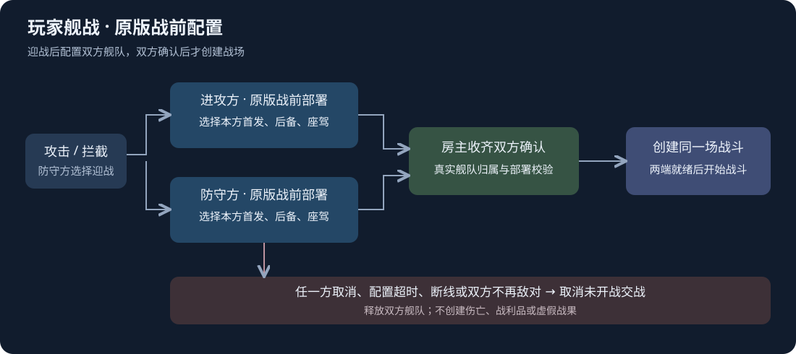

# 原版战前配置接入

用户明确要求：攻击不会立刻进入战场，必须经过原版战前配置，取得双方舰队最终配置后再开始战斗。

## 改动目标

原有流程已经有“攻击 → 防守方迎战／逃跑”，但迎战后 `BeginPlayerFleetBattle` 直接构造双方舰队并调用 `BattleContext.EnterBattleTest`，中间缺少原版战前部署。

本轮保留迎战／逃跑，补为：

1. 防守方选择迎战，双方完成离图与同步屏障。
2. 两端分别打开原版 `PageBattleDeployment`，配置本方真实舰队的首发、后备、顺序与座驾，携带原有旗舰及原版阵型。
3. 将选择结果交给房主。仅一方确认时继续等待；房主收齐并校验双方最终配置后才授权创建战场。
4. 各端以房主确认的双方配置构造隔离战斗视图，两端就绪后进入既有唯一模拟与控制流程。

## 原版接入依据

- 原版 `BattleFlowController.OpenDeploymentPage` 使用 `UIHelp.showPageBattleDeployment`、`InitSession` 和关闭／确认回调。本轮复用该页面与部署数据，不新增自制舰队选择页。
- 原版 `StartCustomBattleWithDeployment` 在玩家确认部署后也通过 `BattleContext.EnterBattleTest` 进入双舰队战场。该名称含 `Test`，但它是当前原版公开的双舰队入口；本轮保留此入口，将其放在双方配置确认之后。`EnterBattle` 接收 world-site/NPC 数据，不适合替代玩家双方舰队。
- 原版部署页面不开放舰船改装，本轮配置承接部署选择，不另开舰船改装、资产赠送或战利品流程。

## 权威与取消

- 配置绑定本场战斗编号、权威任期、玩家及舰队，房主根据真实舰船校验名单、顺序、首发／后备、座驾／旗舰与部署点数；不从客户端接收整份可伪造的永久舰船数据。
- 双方配置分别保存，防守方配置不能由进攻方默认结果替代。确认配置应用于隔离战斗视图；永久资产损伤及人员结算继续使用既有流程。
- 战前配置使用独立的 600 秒房间时间期限，暂停时停表；离图及场景加载使用独立的 45 秒阶段期限。取消、超时、断线或关系改变在未开战时取消本次交战，释放舰队，不生成伤亡或战利品。

## 交付边界

本轮版本 V1.51，网络协议 11。房主与客人需要使用同版本。

默认仅从主仓库通过 `Sync-ModCopies.ps1 -BuildOnly` 分别构建 Project3、Steam 和 TapTap 包，不安装、不覆盖运行副本。未启动游戏、Play Mode、自动测试或跨机验收；游戏内效果由用户执行验收。

## 交付结果

- 功能本地提交：`311e5e8`（`fix: require both native fleet deployments before player battle`），未推送。
- 三端 `Sync-ModCopies.ps1 -BuildOnly` 已完成，版本 V1.51 / 1.51.0.0，同源 `79AA9E9F1C727010EF5A0A5B91C597B7C6C4513E7192E4A3F9DBDC279BE0F06A`。保留原有三项 CS0649 警告；Steam/TapTap 构建各解析 1670 个直接成员引用。
- 回执：[fleet-native-preparation-build-20261019.json](fleet-native-preparation-build-20261019.json)，`Completed=true`、`BuildOnly=true`、`Installations=[]`、`RuntimeTested=false`。
- 本轮固定包保存在 `artifacts/fleet-native-preparation-20261019/packages`，包含 Project3、Steam、TapTap 三个 ZIP，避免后续任务更新公共包路径后混淆本轮交付。
- 首轮编译期间另两项并行源码变动触发来源保护，未交付该轮产物；待对应源码冻结后重新完成三端统一构建。运输修复属于另一个任务，本轮包包含冻结时的实际工作区，不将它认领为本轮修改。
- 保护所有历史未提交源码。本次接口及版本只暂存明确新增的成员／常量，没有顺带提交旧接口重构；完整工作区相对本轮开工的窄差异保存在 [fleet-native-preparation-20261019.patch](../patches/fleet-native-preparation-20261019.patch)。历史混合依赖仍未全部签收，不能把本轮局部提交当作干净仓库的完整重建闭包。

原版页面只提供部署选择，未新增舰船改装或旗舰改选。双端战斗表现、配置取消及后备补位仍待用户游戏内验收，保留[用户验收待办](../../agent-tasks/待办/玩家舰战原版战前配置-用户验收.md)。
