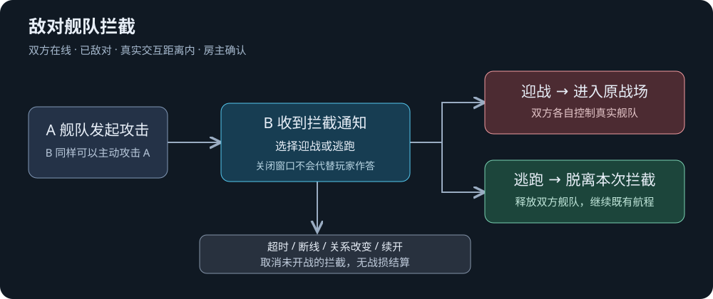

# 舰队拦截、迎战与逃跑

本轮依据用户提供的舰队关系图实现；逃跑方式已由用户明确选择：直接脱离本次拦截，返回太空继续航行。

## 行为

- 在线敌对双方在原生交互距离内，可以通过远端舰队原有“攻击”入口发起拦截；中立、友好不会因点击而自动改成敌对。
- 攻击后先等待防守方选择。防守方自动收到迎战／逃跑窗口；关闭或 ESC 只关闭窗口，可通过右上方拦截通知重新处理，不默认作答。
- 迎战由房主重新检查身份、在线、归属、敌对、真实接触和回应期限，保存后进入既有真实舰战准备与控制流程。
- 逃跑直接取消本次未开战拦截，释放双方舰队，保留既有航程、人员与资产；没有逃跑概率、战损或额外奖励。没有既有航程时不会代替玩家选择新目的地。
- 等待期间暂停双方舰队推进；不退出地表、不创建战场、不结算资产、不展示已经交火的特效。45 秒房间时间未回应则取消，房间暂停时期限不推进。关系变化、断线、关闭或续开取消尚未开战的拦截。
- 回应仅防守方可以提交，带权威任期；过期或越权回应不触发入场，重复回应不重置战斗准备。保存失败恢复原等待状态。

## 接入文件

- `src/Core/PlayerFleetBattles.cs`：追加等待回应阶段、期限和回应消息，保留既有阶段整数值。
- `src/Session/PlayerFleetBattles.cs`、`PlayerFleetIntercepts.cs`：房主状态转换、计时、退出和恢复分支。
- `src/Entry/MultiplayerFleetInterceptDialog.cs`、`MultiplayerFleetInteractionDialog.cs`、`ModPluginLauncher.cs`：通知、选择入口和状态展示。
- `src/Game/NativeRemoteFleetProxy.cs`：等待回应不显示已开战特效。
- `src/Core/Protocol.cs`：正式交付时提升协议，防止旧端把新等待阶段当成已开战。

## 交付状态

V1.39（程序集 1.39.0.0），网络协议 7，存档结构 1。2026-10-19 已执行 `Sync-ModCopies.ps1`，三端分别引用真实目标程序集编译并安装完成，只有原有三项 CS0649 警告；Steam/TapTap 构建各解析 1670 个直接运行库成员引用。未运行测试、游戏或跨机验收，按用户要求由用户执行游戏验收。

三端同源 `FAAEF97C0FECAE3AF1EDC53FD4FB9FEE2F042AA6F98870D994CC76D8A8F57018`。汇总回执 `artifacts/last-copy-sync.json`，本轮另存 `artifacts/fleet-intercept-20261019/copy-sync.json`。独立安装回执：

- Project3：`artifacts/installations/20261019-070418-1cace6b1/receipt.json`。
- Steam：`artifacts/installations/20261019-070420-b3355626/receipt.json`。
- TapTap：`artifacts/installations/20261019-070424-dcc079e5/receipt.json`。

安装范围仅三个 `mods/FreeWorldMultiplayer`，包含工作区已整合的 V1.36 续开与 V1.37／1.38 地表修复；这些前轮历史混合源码保持原状，并非全部由本轮 Git 提交签收。房主和客人均需重启／重新加载本 MOD 后再进行游戏内验收。

本地 Git 仅提交本轮修改。`Protocol.cs` 的统一版本消息处理与 Launcher 的通信 UI 接线本来就是历史混合未提交代码；索引只加入本轮新版本常量和两处拦截 UI 调用，不吞入旧实现。相对本轮原工作区的完整源码增量另保存在 [fleet-intercept-20261019.patch](../patches/fleet-intercept-20261019.patch)，因此三端安装依据是上述实际工作区 SourceRevision，不能把窄提交当作已有全部历史依赖签收的干净可重建仓库。

功能本地提交：`c65503d`（`feat: let intercepted fleets choose battle or escape`），未推送。后续交接记录提交不修改构建输入或已安装包。

建议用户更新双方后，分别检查 A 攻击 B 与 B 攻击 A；选择迎战和逃跑；关闭通知后重开；超时、关系改为中立以及防守方断线后舰队解锁。
