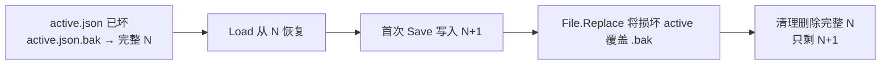

# 联机 MOD 第四轮静态 BUG 审计与 Agent 修复交接

> 审计日期：2026-10-17
> 主仓库：`C:\Users\CatStudio\Desktop\FreeWorldMods\FreeWorldMultiplayer`
> 审计起点：`HEAD=cd24476`，工作目录 `VERSION=1.23`，包含其他 Agent 原有未提交和未跟踪源码；**不是干净 Git 提交，不等于已安装的运行 DLL**。
> 任务边界：只读分析功能代码，新增本 MD、协作登记与主控留言。**没有修改业务实现、玩家存档、游戏本体或三端运行副本；没有启动游戏、执行联网对抗测试或声称修复成功。**

> **并发变更：**审计期间另一 Agent 已独立提交 BUG-02 回复映射代码及任务分拣，`HEAD` 后续推进至 `e252f7f`。本报告只研究列出的业务源码路径，不撤销它的提交；接手时以当下源码重新核对各项判断。

本报告是 [第一轮 BUG-01～05](联机MOD静态BUG审计与Agent修复交接-20261017.md)、[第二轮 BUG-06～10](联机MOD第二轮静态BUG审计与Agent修复交接-20261017.md)、[第三轮 BUG-11～14](联机MOD第三轮静态BUG审计与Agent修复交接-20261017.md) 的**增量审计**，仅新增 BUG-15～18。

## 1. 阅读约定与汇总

- **确认代码行为**表示直接读到了源头及调用链，不表示游戏内已复现；涉及故障、异常客户端或大体积数据的影响须专门验证。
- **P1** 为可能损害存档恢复链、房主服务可用性或 UID 权威完整性的高优先级问题；**P2** 为可量化但尚无实测的 UI/存储性能风险。等级不代表触发频率。
- 新报告不要求立即改代码；接手 Agent 应按 `AGENTS.md`、`Agent.md`、`联机方案 V1.md`、`AGENT-COORDINATION.md` 与 `GIT-COMMIT-POLICY.md` 的文件独占、冻结、版本和提交规则办理。

| ID | 优先级 | 模块 | 新增发现 | 证据级别 |
| --- | --- | --- | --- | --- |
| **BUG-15** | **P1** | Core / SaveStore | 从 `active.json.bak` 恢复后首次保存，可能覆写有效备份并删除唯一旧完整代 | 保存顺序确认；恢复后的二次损坏需注入 |
| **BUG-16** | **P1** | Session / UID / Save | 已认证客户端重复请求 `uids` 可不断预留百万号段并触发整个世界完整保存 | 无门禁调用链确认；压力影响待测 |
| **BUG-17** | **P1** | Authority / Game delta | `MapUpdate.EntityOwners` 新实体路径没有经过 `owner` 消息使用的 UID 号段校验 | 校验边界不一致确认；伪造差量影响待测试 |
| **BUG-18** | **P2** | Core / Entry | 存档列表刷新逐个完整反序列化存档，可能阻塞 Unity 主线程 | 同步全量读取确认；耗时待基准 |

## BUG-15：备份恢复后的下一次保存可能销毁最后一份有效回退链

**负责人建议：Core / SaveStore。状态：待复核和修复。**

### 代码证据

- `src/Core/Storage.cs:193-219`：`Load(worldId)` 尝试 `active.json`，失败后回退读取 `active.json.bak` 并加载旧代 `generation_N.json`。
- `src/Core/Storage.cs:66-85`：`AtomicFile.Write(path,data)` 在原目标文件存在时调用 `File.Replace(temp,path,path+".bak")`；这会以**替换前的目标文件**更新同名 `.bak`，不论该目标是否损坏。
- `src/Core/Storage.cs:141-179`：`Save` 写完新代后替换 `active.json`，然后**仅**从当前 `active.json.bak` 读 previous 指针，删掉既非本代、又非该 previous 指向的 `generation_*.json`。
- `src/Session/MultiplayerSession.cs:222-254`：`HostLoad` 通过 `saves.Load` 恢复、随后仍调用 `SaveOrThrow()`，所以“恢复后首次保存”是正式业务路径，不必等待手动保存。

### 确定性顺序

1. 磁盘 `active.json` 已损坏，但 `active.json.bak` 仍指向**有效的**旧代 N（如停电中断的原子替换）。
2. `Load` 成功从 `.bak` 恢复 N，房主进入 `HostLoad` 后调用 `SaveOrThrow` 创建新的完整代 N+1。
3. `File.Replace(temp, active.json, active.json.bak)` 会把**损坏的 active 指针**覆盖原先有效的 `.bak` 指针。
4. 清理阶段 `TryPointer(active.json.bak)` 无法读到旧代 N，于是把 `generation_N.json` 也删除，只保留 N+1。
5. 如果新代 N+1 后来损坏，就失去了本来还能恢复的代 N；当前成功保存本身**不等于立即数据丢失**，风险是恢复链被降级。



### 修复方向

保存前显式保留**已验证**的最近有效指针／代内容，并确保不会由 `File.Replace` 的自动备份覆盖它；清理集合基于成功校验的 current+recovery（或显式代保留策略），而不是只相信刚生成的 `.bak`。写失败需保持旧可恢复文件完整。切勿自动“修复”玩家真实存档以做测试。

### 最小验收

在独立临时测试目录构造 `active.json` 损坏而 `active.json.bak`+代 N 完整的文件集：验证列表判定可恢复、`Load` 恢复、首次 `Save` 成功后代 N 和可读回退指针均仍存在；再次人为损坏 N+1，必须仍能回退 N。补正常双代、缺失 active 和保存中断用例；对目录内容进行哈希比对，不触碰玩家真实文件。

## BUG-16：`uids` 请求缺乏限流/去重，触发无限号段预留与存档风暴

**负责人建议：Session + UID/Core 存储。状态：待复核和修复。**

### 代码证据

- `src/Session/Networking.cs:185-192`：已认证 peer 发来 `"uids"` 时，房主直接 `ReserveUidRange(false)` → 更新 `recipient.Uids` → `IssuedUidRanges.Add(range)` → `SaveOrThrow()` → `Send(peer,"uids",range)`。
- `src/Session/Authority.cs:20-29`：每次 `ReserveUidRange` 将 `World.UidHighWater` **增加 1,000,000**；此函数并不知道客人是否真的耗尽原有号段。
- `src/Session/Authority.cs:31-46`：正常客户端仅在接近耗尽或真正耗尽时请求扩容，但服务端收到 `uids` 不核验 `Next`、剩余数量、待处理申请或请求节奏。
- `src/Session/MultiplayerSession.cs:438-485`：`SaveOrThrow` 捕获世界及所有玩家状态、检查完整地图并写新代；属于较昂贵的**权威全量保存**。
- `src/Session/PlayerChat.cs:~58-66`：聊天等交互有 `ConsumeCommunicationRate`；`uids` 不走这个限流分支。

### 触发条件和影响

已通过认证的客户端（出错的插件或被修改的客端）连续提交多条 `uids` 请求。每一条都增加 100 万 UID 预留跨度和一项 `IssuedUidRanges`，而且可能要求房主逐条完整保存世界。由于尚未看到回包失败后的请求去重与上限，这条路径存在高频 IO / CPU / 磁盘压力和内存增长风险。**本轮没有发包或测得游戏卡顿时长，也不能假定未经认证的连接能调用此路径。**

### 修复方向

增加“当前号段剩余量/最早续领阈值 + 单人仅一个待确认新号段 + 幂等申请 ID + 有界请求速率”，超量须明确拒绝并留诊断，不应继续完整存盘。老的有效 UID 仍能去重，防止发放重试重用已分配 ID。分配与保存顺序要兼顾崩溃安全，不能通过“先发送成功再保存”绕过持久化。

### 验收

模拟一个正常 near-exhaust 客人和一个不断重复请求的已认证测试客人。记录 `UidHighWater`、`IssuedUidRanges.Count`、存档调用次数、总序列化时间与内存；重复请求不能每次再增长 100 万 UID 或重做完整保存，正常首次续领及崩溃重连不能发生 UID 重用。

## BUG-17：地图差量的实体归属登记绕过显式 UID 号段门禁

**负责人建议：Session/Authority + Game/NativeMapReplicator。状态：边界缺口已定位，严重性需受控畸形输入验证。**

### 代码证据

- `src/Session/Networking.cs:195-200`：显式 `"owner"` 消息要求 `owner.EntityId` 落在发送者当前会话 `IssuedUidRanges` 内，且地图模拟者、任期及允许的归属均匹配。
- `src/Session/Authority.cs:381-409`：同一已认证模拟者提交 `MapUpdate` 时，`update.EntityOwners` 的每项仅验证目标 `PlayerId` 存在及没有改变已登记的旧 UID 归属；**对新 UID 未调用 issued-range 校验**。
- `src/Session/Authority.cs:420-444`：随后执行 `bridge.ApplyMapUpdate(update)`，并通过 `RegisterOwner` 将此前未知的 `EntityOwners` 写入房主全局归属表；`RegisterOwner` `src/Session/Authority.cs:48-53` 本身只检查非负 UID、已知玩家及冲突。
- `src/Game/NativeMapReplicator.cs:554-635`：原生 `Validate(MapUpdate)` 校验实体类型、标识一致性、字段、地形与登陆/战利品约束；在该函数中也未找到针对发送者 `IssuedUidRanges` 的校验。

### 风险边界

此问题**不是**普通客户端只要点击一次就能更改别人的资产：服务端仍要求其为当前地图有效模拟者并校验原生差量。风险是**已掌握某张地图模拟权、且能构造异常差量的客端**可尝试为原本未知的 UID 登记不受发号水位限制的归属，造成 UID 冲突、幽灵归属或不应存在的实体记录。需要在沙盒中证实整个原生差量确实可通过其他限制，不能把推断写成实机成功利用。

### 修复方向

统一 “owner 注册包、地图差量、完整地图恢复” 的**新 UID 来源规则**，将合法的初始资源/房主 NPC 与分配给客人的 UID 区分。对新增实体执行来源及上限验证、冲突前置校验和全事务拒绝；既有合法实体变更仍使用稳定归属，不按当前玩家 UID 号段重判旧角色。与 BUG-01 的权威地图提交原子性一起评审，不为通过校验而随意把新角色归房主。

### 验收

使用测试世界与受控差量：①合法客人当前号段创建本人雇员；②合法已存在的其他玩家雇员继续在同一图更新；③新 UID 不属于已发号段；④与其他世界已用 UID 碰撞；⑤未知 PlayerId；⑥切换地图任期之后的旧差量。后四类在原生资产修改前被拒绝，且不会注册污染 `World.EntityOwners`。

## BUG-18：存档列表为了显示元数据而逐份完整加载世界，存在主线程阻塞风险

**负责人建议：Core/SaveStore + Entry。状态：复杂度问题确认，实际 UI 延迟待测。**

### 代码证据

- `src/Core/Storage.cs:114-138`：`SaveStore.ListWorlds` 遍历每一个联机世界目录，直接调用 `store.Load(id)` 取 `Name`/`SaveGeneration` 等列表元数据，以便验证备份仍可恢复。
- `src/Core/Storage.cs:193-216`：每次 `Load` 均同步 `File.ReadAllBytes(pointer.File)`、SHA256 计算、`JsonData.Read<WorldState>` **完整反序列化**；损坏主代还可能再读备份。
- `src/Entry/MultiplayerLobbyPages.cs:111-120`：`RefreshWorlds()` 在 UI 回调中直接调用该同步 `ListWorlds`。
- `src/Entry/MultiplayerRoomDialog.cs:118,214`、`src/Entry/MultiplayerLobbyPages.cs:34`：初次创建房间面板、完成一次会话、点击“继续世界”都可能触发刷新。

### 风险边界与修复方向

扫描 N 份存档的成本变成至少读取、校验、反序列化所有当前完整代文件，内存分配随存档总量增长；每次刷新均在 Unity 主线程同步执行。这是**代码上的线性全量扫描事实**，但没有实际存档大小和耗时样本，本轮只定为 P2 风险。建议将“列表健康摘要”与“真正 `Load` 恢复动作”分层：可靠指针摘要、缓存健康状态、显式选择时再做完整 SHA/世界反序列化或分时分批检查；绝对不能把“没校验的当前指针”显示为“已确认可继续”（否则会退回第一轮 BUG-03）。

### 验收

在独立测试目录构造 1、10、50 份不同大小（如 5/50/200 MiB）的有效与损坏存档；记录 UI 主线程最长停顿、分配峰值、I/O 字节数、首次显示耗时，并确认正常、可从备份恢复、双代损坏三类状态与真实 `Load` 一致。选择存档后必须再次校验，缓存元数据不得成为资产权威。

## 2. 跨 Agent 分工与修复顺序

1. **优先 BUG-15**：直接影响可恢复性；先做完全隔离的文件夹故障注入测试，修复不能覆盖真正的玩家存档。
2. **BUG-16 与 BUG-17 联审**：房主 UID 发放和实体登记是同一个安全边界；设计一致后分别提交精确小补丁，避免修改游戏自身 UID 规则或破坏原资产。
3. **BUG-18 独立优化**：必须保留 BUG-03 新增的恢复正确性，不能为了提速去掉校验。
4. `src/Core/Storage.cs`、`src/Session/Networking.cs`、`src/Session/Authority.cs`、`src/Game/NativeMapReplicator.cs` 和 Entry 页面目前均含历史混合工作区改动。报告只占用新增 MD、协调表本行与主控邮箱本条；**原 Owner 未签收前不得抢写源码**。
5. 所有问题分别回填修复 commit、VERSION/CHANGELOG、三端 BuildOnly、磁盘安装与真正运行加载 SourceRevision、双端游戏验收和回滚说明。**编译通过不等于游戏已验证。**

## 3. Agent 修复回填模板

```text
BUG 编号 / 状态：
负责人、原文件 Owner 交接：
当前源码是否仍存在上述路径：
最小重现条件、故障注入与实测日志：
修复文件、提交哈希、测试用例：
是否改变协议、存档 Schema、UID 或玩家身份：
P3 / Steam / TapTap BuildOnly：
安装磁盘 SourceRevision / 真实运行 SourceRevision：
用户联机实机验收：
未解决问题、回滚方法：
```

**最终审计声明：**新增 3 项具有明确权威/存储保护缺口的条件性 BUG，以及 1 项尚待量化的性能风险。未执行游戏、PlayMode、跨机联机和真实玩家存档的破坏测试；未宣布这些 BUG 已实机复现或完成修复。
