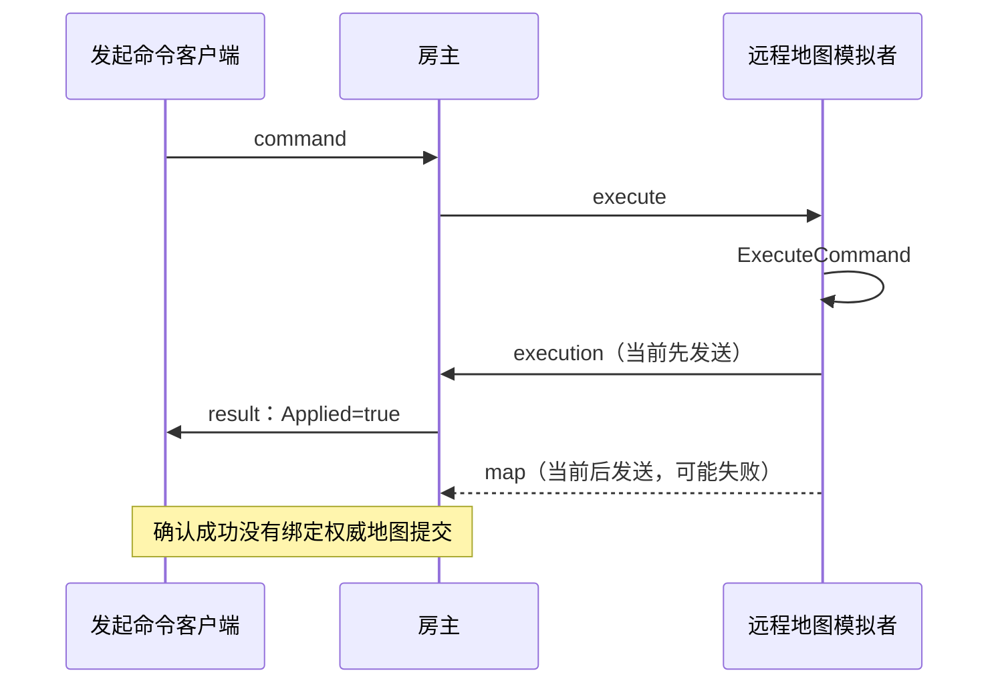

# 联机 MOD 静态 BUG 审计与 Agent 修复交接

> 审计日期：2026-10-17
> 仓库：`C:\Users\CatStudio\Desktop\FreeWorldMods\FreeWorldMultiplayer`
> 版本：`VERSION=1.19`；审计开始时 `HEAD=516d51c`
> 审计基准：**HEAD + 审计时本地未提交／未跟踪源码**，不是纯净提交，也不是已安装 DLL。
> 工作性质：**仅源码静态审计、记录与交接；未修复功能、未构建、未安装、未启动游戏或做双端验收。**

## 阅读说明

- **代码确认**：引用的逻辑与调用次序已在当前工作区直接读取；不等于已在游戏内复现。
- **触发条件待验**：代码可构成故障，但需要故障注入、压力测试或双端实机确认可达性和影响。
- 优先级：**P1** 涉及权威结算／存档一致性；**P2** 涉及长期运行、恢复能力或输入健壮性。
- 接手 Agent 先读 `AGENTS.md`、`Agent.md`、`联机方案 V1.md`、`AGENT-COORDINATION.md` 和 `GIT-COMMIT-POLICY.md`，核对当前源码是否已经变更及归属是否可修改；本文件不是直接开工／覆盖他人文件的授权。

## 本轮发现概览

| 编号 | 优先级 | 证据结论 | 模块 | 摘要 |
| --- | --- | --- | --- | --- |
| **BUG-01** | **P1** | 代码确认；断包后果待故障注入 | Session / Authority / Networking | 远程执行回执早于权威地图差量提交，可能出现“命令已成功、地图未提交” |
| **BUG-02** | P2 | 代码确认 | Session / Networking | `commandReplyPeers` 对即时完成的客户端命令只增加、不释放 |
| **BUG-03** | P2 | 代码确认 | Core / Entry | 有效备份代可由 `Load` 恢复，却被继续存档列表挡在 UI 外 |
| **BUG-04** | P2 | 代码确认；畸形输入触发待测 | Session / Authority | 地图事务 `Players=null` 在原生变更后触发空引用 |
| **BUG-05** | P2 | 增长路径代码确认；影响需压测 | Session / Core | 命令事务、远程已执行命令记录无清理，导致长期内存与存档膨胀风险 |

## BUG-01：远程命令确认与权威地图提交未绑定

**状态：待修复／P1／代码确认的顺序缺陷。** 建议负责人：Session（命令状态机）+ 地图同步 Agent（事务提交），由主控协调跨模块契约。

**源码证据：**

- `src/Session/Commands.cs:198-201`：房主把命令记录到 `pendingExecutions`，发送 `execute` 给另一台地图模拟者。
- `src/Session/Commands.cs:206-218`：模拟者调用 `bridge.ExecuteCommand` 后**先** `Send("host", "execution", result)`，**后** `PublishLocalMaps()`。
- `src/Session/Networking.cs:191` 附近：`execution` 进入 `AcceptExecution`，而 `map` 进入 `AcceptMapUpdate`，属于两次消息处理。
- `src/Session/Commands.cs:220-230`：`AcceptExecution` 随即从待执行表删除命令、写入 `World.Transactions[key] = result` 并向发起人回送 `result`，不等待 `map` 已完成权威提交。
- `src/Session/Commands.cs:50-59`：同一个命令 ID 重试会直接读取已有 `World.Transactions`；`src/Core/Contracts.cs:209` 附近 `CommandResult.Ok` 表示 `Applied=true`。

**触发场景与风险：** 在“玩家 A 下达自己当前不负责模拟地块的指令、玩家 B 是该地图模拟者”的条件下，B 执行原生操作后 `execution` 已被房主处理，随后 `map` 在网络断开、版本拒绝、模拟权交接或发送失败中未被提交。房主及 A 已记录成功，但房主的权威地图尚没有对应变化；保存、重连或同 ID 重试可能继续使用错误的成功回执。**该失配窗口从源码可见，但尚未实施断包注入，不能宣称实机已经发生数据丢失。**



**修复方向：** 为命令建立 `Queued → ExecutedPendingCommit → Committed / Rejected` 状态；只有与命令关联的地图修订／提交 ID 经房主核验并真实提交，才能写入终态 `Applied=true` 和通知发起者。处理重试、超时、模拟者离线、模拟权变化、`mapRejected`、断包与 Save/Load；不能通过固定成功、忽略地图 ACK 或重复执行原生命令绕过该问题。若改成原子事务封包，须同时维护既有实时地图序与个人字段版本门禁。

**验收：** (1) 在 `execution` 和 `map` 之间强制断线，绝不返回最终 `Applied=true`；(2) 地图变更真正提交后只确认一次；(3) 同一命令 ID 重传不重复扣物品或执行原生副作用；(4) 模拟权切换及重启存档后仍能判定终态；(5) 双端实机复核动作、地图和存档一致。

## BUG-02：`commandReplyPeers` 即时命令的记录无法释放

**状态：待修复／P2／代码确认。** 建议负责人：Session。

**源码证据：**

- `src/Session/Networking.cs:163-172`：对**每一条**已认证客户端的 `command`，不区分同步执行和远程异步执行，执行前一律 `commandReplyPeers[TransactionKey(command)] = peer`。
- `src/Session/Commands.cs:228-229`：只有 `AcceptExecution` 远程模拟者完成时才 `commandReplyPeers.Remove(key)`；立即在房主执行的舰队、关系、进／离地图命令和立即失败的命令不经过此分支。
- `src/Session/Networking.cs:410-428`：`RemovePeer` 不回收该表中由离线 peer 创建的记录；未找到其他删除或上限分支。

**触发场景与影响：** 任意客人在一次长房间中频繁控制舰队／切地图／设置关系，字典会随**唯一命令 ID**持续增长；离线后的记录也继续存在。若命令恰好走另一条异步执行链，还需确认新修复不会丢失其真实终态回执。

**修复方向：** 仅给 `pendingExecutions` 异步命令保存 reply 映射，或在同步完成、拒绝、发送失败、peer 断开及超时各出口统一释放；与 BUG-01 的真正提交状态协调，确保“提前释放”不使异步命令丢失回执。

**验收：** 连续执行数千次即时命令和错误命令，核对 pending/reply 记录数回到 0；断开／重连后旧 peer 映射为 0；跨客户端委托执行仍只得到一次最终回执。

## BUG-03：存档备份存在但继续游戏 UI 无法恢复

**状态：待修复／P2／代码确认。** 建议负责人：Core（存档）+ Entry（继续世界列表）。

**源码证据：**

- `src/Core/Storage.cs:113-129`：`SaveStore.ListWorlds` 仅检查／读取 `active.json`；文件不存在就直接跳过，解析失败则设置 `WorldSummary.Error`。
- `src/Core/Storage.cs:183-207`：`SaveStore.Load` 已明确尝试 `active.json` **以及** `active.json.bak`，校验代次和 SHA 后可退回备份。
- `src/Entry/MultiplayerLobbyPages.cs:65-68,164-165`：`WorldSummary.Error` 非空时，继续世界按钮禁用且点击后也拒绝调用 `HostLoad`。

**触发场景与影响：** 写入中断导致当前 `active.json` 损坏／丢失、但 `active.json.bak` 和其引用的代文件仍完好。底层 `Load` 有恢复能力，UI 列表却把存档判为不可继续，或根本不列出，用户误以为世界不可恢复。

**修复方向：** 让列表和 `Load` 共用只读的指针／代校验路径；区分“当前代可读”“当前代坏但备份可恢复”“全部损坏”，对可恢复项允许进入且明确提示会回退到哪一代。只调查／列出时不得自动覆盖损坏现场。

**验收：** 构造三组临时联机存档（双代均完好、当前索引损坏但备份有效、双代均损坏），列表提示和可进入状态与真实 `Load` 结果一致，绝不写入或删除原存档。

## BUG-04：地图事务空 `Players` 在应用后才抛异常

**状态：待修复／P2／代码确认；要求针对畸形消息做注入。** 建议负责人：Session / Authority。

**源码证据：**

- `src/Session/Networking.cs:174-178`：房主将收到的 `map` 反序列化为 `MapUpdate` 并交给 `AcceptMapUpdate`；这里没有强制其 `Players` 非空。
- `src/Session/Authority.cs:389-421`：前置校验使用 `update.Players ?? new List<PlayerUpdate>()`，因此允许 `Players=null` 穿过此项检查。
- `src/Session/Authority.cs:422-453`：先 `bridge.ApplyMapUpdate(update)`，然后提交地图修订号、检查点并通知访客。
- `src/Session/Authority.cs:455`：随后出现 `foreach (PlayerUpdate personal in update.Players)`，不再判空，空引用异常发生在副作用之后。
- 正常客户端在 `src/Session/Authority.cs:~333` 会将自己要发的 `update.Players` 填为非空集合，因此此问题主要针对畸形／兼容性异常的已认证消息，而非声称正常双端必现。

**触发场景与影响：** 已认证客户端提交合法其余字段但 `Players=null` 的地图消息，房主可能在原生地图已经改变、修订已经推进后报错；前置输入校验没有提前拒绝，对后续会话一致性不利。

**修复方向：** 在任何原生应用前统一验证或规范化 `Players`（以及依赖集合）；后续循环一律使用同一规范化集合。不要将“原生变更后抛异常”伪装成“未应用，可直接重试”。

**验收：** 构造 `Players=null`、空列表和合法个人差量三个输入；非法数据在变更前明确拒绝，合法空列表不抛异常，地图修订和权威快照只在成功时前进。

## BUG-05：无限期积累的事务历史／已执行命令，可能拖慢长时间游戏

**状态：P2 性能风险／源码增长路径确认，实际耗时和内存影响待压力测试。** 建议负责人：Session / Core 存档。

**源码证据：**

- `src/Session/Commands.cs:118,194,227` 和 `src/Session/RaidRules.cs:135`：每个新唯一事务键写入 `World.Transactions`。
- `src/Session/Commands.cs:207-215`：远程模拟者将每个处理过的命令写入 `executedCommands`。
- 本轮在 `src/Session`／`src/Core` 范围内搜索到这些集合的写入与查询，**未找到** `World.Transactions` 或 `executedCommands` 的清理、容量上限、滚动归档路径。
- `src/Session/Networking.cs:269` 的 `view.Transactions.Clear()` 仅清理发送给客户端的 **克隆对象**，不会清掉房主原始 `World.Transactions`；`src/Core/Storage.cs:149` 持续将完整 `world` 序列化保存。

**触发场景与影响：** 连续游玩、多人高频操作带来新命令 ID 时，原始房主存档中的事务词典持续变大；会话内远程已执行命令表也持续增长。这是**内存／存档体积无上界的静态事实**，但“具体造成多少帧延迟”尚无实测，不能引用历史 2D 停顿作为已证实原因。

**修复方向：** 建立有界近期去重窗口 + **重要操作的持久幂等凭据**／检查点水位。不得直接 `Clear()` 整个交易表；重复赠送、运输、伤害和关键保存仍必须防止二次应用。检查迁移旧档与跨会话唯一 ID 语义。

**验收：** 进行 1k/10k/100k 不同命令序列测试，收集内存、存档字节数、序列化耗时、重连去重正确性；关键命令重试必须 0 次重复副作用；退出后会话局部表应释放。

## 历史现象／外部依赖：不是本轮已证实的根因

1. **客户端太空舰队不能移动（待复现）**：`AGENT-COORDINATION.md` 中 `client-fleet-motion-20261016` 已记录 Steam guest / TapTap host 的 V1.19 现象；当时日志没有证明“点击已提交”或“原生接受后真实位移”，本轮也没有新运行日志。应依据 `src/Game/NativeGalaxy.cs` → `src/Session/Commands.cs` → `src/Session/Networking.cs` → `src/Game/NativeFleetMotionEvidence.cs` 的分阶段日志判断首个失败点，不能直接归因于 BUG-01。
2. **客人地块加载卡顿／停顿与 2D P95（待实测）**：已有历史优化记录，但缺最新双端一致版本的实机时间样本。本轮 BUG-05 属可量化风险，不等同于已确认卡顿根因。
3. **运行副本不是最新源码（交付门禁）**：协调表最新 `optimization-r13-runtime-copy-evidence-20261017` 记录三端磁盘 DLL 与 `BUILD-INFO.json` 源自较旧修订，主仓库还留待 Owner 交接的混合改动。必须**分别验证源码、三端 BuildOnly、磁盘安装、实际加载及游戏表现**；不能把本次工作树分析当作已安装的 V1.19 运行结果。

## Agent 执行顺序、独占范围和验收门禁

1. **Session 主责先处理 BUG-01**：和地图权威模块约定提交 ID、最终回执、失败状态及 Save/Load；确保顺序一致后再处理 BUG-02（同一 reply 生命期）。
2. **Core + Entry 处理 BUG-03**：只读可恢复索引；不能破坏旧存档或静默换代。
3. **Session 处理 BUG-04**：防御性校验位于原生应用前，增加负向消息测试。
4. **Session + Core 处理 BUG-05**：先压测确立规模与开销，再确定持久去重设计；不能为了性能删掉关键幂等记录。
5. 每项修复单独记录源码变更、回归用例、Git 提交、版本变动及测试结论，按 `GIT-COMMIT-POLICY.md` 精确暂存自己文件；未取得跨模块 Owner 交接，不修改其他 Agent 混合代码。
6. 正式构建／三端同步前先通过 `AGENT-COORDINATION.md` 的源码交接门禁；Project3 本体、Steam/TapTap 游戏本体与共享 Harmony 均不可改。运行中的客户端实际版本要由用户确认。

## 修复回填模板（每个 BUG 单独更新）

```text
BUG-ID：
负责人／文件独占确认：
修复状态：待认领 / 调查中 / 已修复待验 / 已验收
根因复核与触发证据：
实际修改文件和提交：
测试：静态逻辑 / 三端 BuildOnly / 磁盘安装 / 双端实机（分别填）
是否更改协议、存档或版本：
回滚说明及未完成依赖：
```

**本轮结论：** 发现 4 个具有可定位源码路径的故障／漏洞，以及 1 个持续增长的性能风险；报告只说明当前代码和条件影响，不把它们宣称为已由实机复现或已修复。
