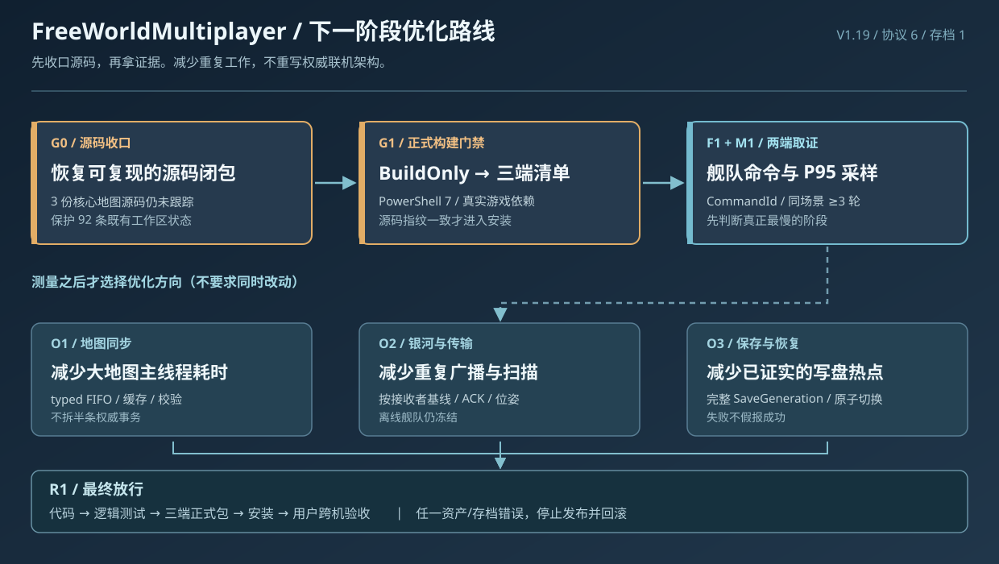

# FreeWorldMultiplayer · 下一阶段优化开发案

> **执行方案 / 2026-10-16** · 当前主仓库发布标记：`V1.19`，联机协议 `6`，存档结构 `1`。
>
> 本文是 [原优化案](联机插件优化开发案.md) 的**下一轮实施单**，不是新的玩法版本，也不替代 [联机方案 V1](../联机方案%20V1.md)。旧优化案的 S0～S5 仍保留；本单只回答“接下来实际改哪些、先做什么、怎么证明做对了”。

> **下一阶段实施回执：** [2026-10-16 实施与构建记录](联机优化第三轮实施回执-20261016.md)。G1 PowerShell 7 环境与三端 `BuildOnly` 已打通；G0 Git 完整源码闭包仍未放行。

## 1. 本轮核对到的现状

| 已有证据 | 意义与限制 |
| --- | --- |
| 本地主仓库 `VERSION` = `1.19`；`Protocol.CurrentVersion` = `6`；存档 `SchemaVersion` = `1` | 本轮只做优化规划；不擅自更改三种版本或 V1 玩法 |
| 本轮调查开始时 Git `HEAD` = `c0cd3f0`（本案提交后会前进）；当时工作区有 **92** 条未提交/未跟踪状态；`src/Core/MapSnapshotDeltaCodec.cs`、`src/Session/MapSnapshotCache.cs`、`src/Session/MapViewLoading.cs` 仍未被 Git 跟踪 | **第一优先级是建立可复现源码闭包**。不能只拿某个提交号当成全部可构建源码；不能 `git add -A` 吞掉其他 Agent 的代码 |
| 先前已落地：舰队命令 `CommandId` 分段诊断、可选性能直方图、房间广播编码复用、地图缓存 typed FIFO/一次缓冲重组；已有记录显示 **40 项纯逻辑检查**及三端静态编译曾通过 | 代码存在不等于运行包已更新；更不等于实机性能提升。未确认三端最新包已安装、加载并验收 |
| 既有 Steam 客端日志：一条 `20,955,155 bytes` 消息 `transport.decode=187.7 ms`、`transport.handle=6943.3 ms`；`maps.publish=1065.9 ms` | 确实存在主线程长事务；不能只由消息大小推断 6.9 秒都花在网络解析 |
| 既有 TapTap 房主日志：`transport.handle=3711.5 ms`，对应消息仅 `289 bytes`；另有 `maps.publish=693.8 ms` | **小消息也可能触发昂贵业务操作**，应分解阶段确认真实耗时，不是盲目压缩/调低发送频率 |
| `Sync-ModCopies.ps1` 要求 PowerShell 7；本轮已核对 `pwsh` 未在当前 PATH；Project3、Steam、TapTap 目标游戏程序集文件存在 | 正式 `-BuildOnly` / 同步的可用性仍是门禁；不可以历史 Roslyn 编译输出代替正式安装包 |
| 尚无携带新 `[fleet-command]` 与 `[profile]` 的同一场景双端运行数据 | “客人舰队不能移动”的根因、优化 P95、地图缓存收益 **均未证实** |

**最高风险不是“没有继续写优化代码”，而是源码未收口、工具链未闭环、运行证据不足。** 因此先做门禁，再按数据选择热点。

## 2. 优化目标与不变量

在用户自己完成实际多端游戏验收之前，所有优化都标记为“静态/逻辑验证”，不能写“已修好、已提速”。

- **响应**：舰队指令从原版输入到房主判定、回执、权威运动/客端显示链路可定位；不再出现无记录的“点了没反应”。
- **性能**：对确定的热点，目标同场景 P95 耗时下降至少 **25%**，其他核心路径 P95 不恶化超过 **10%**；阈值是建议验收线，**并非现有成果**。
- **同步**：热图内容块有效复用、增量正确；同星系舰队实时互见；接收队列和内存有界，不静默丢权威消息。
- **安全**：一图只有一个模拟者；`AuthorityEpoch / Revision / CommitId`、玩家 `PlayerId`、`TransferId`、ACK/重同步和完整 `SaveGeneration` 不被绕过。
- **游戏规则**：保留单机/联机存档隔离、独立玩家资产、在线战斗与离线袭击、唯一一次撤离及冷却、离线舰队冻结等 [V1 既定规则](../联机方案%20V1.md)。

## 3. 按门禁推进的开发任务

| 顺序 | 开发任务及文件归属建议 | 必须交付的证据与放行条件 |
| --- | --- | --- |
| **G0 · P0 源码收口** | 主控协调 Game / Session / Core 各原负责人，清点 `git status` 与源码生成/依赖闭包；对三份未跟踪地图源码和所有被引用的未提交功能**逐文件核对归属、差异和依赖**，只将明确授权的独立任务范围提交 | 可从被记录的源码闭包复现三端编译；其他 Agent 改动完整保留；所有任务有清晰提交/来源记录，不能用 `git clean/reset/add -A` 处理 |
| **G1 · P0 正式构建门禁** | 主控只核查/补齐 PowerShell 7 环境、真实游戏引用与已有 `Sync-ModCopies.ps1`；不另写平行部署脚本 | 先 `-BuildOnly` 成功生成三端包，`BUILD-INFO.json` 的 `ReferenceMode / SourceRevision / ModVersion` 符合目标；正式安装另行检查游戏关闭、共享 Harmony 和路径，不替换本体 |
| **F1 · P0 舰队移动闭环** | Game：`NativeGalaxy.cs`/原生 Hook；Session：`Commands.cs`/`Networking.cs`；Entry 仅展示真实拒绝 | 客人/房主同一条 `CommandId` 的 `native.hook → session.submit → client.sent → host.received → host.native.begin/end → client.result` 可配对；若仅到某一步，定点查该步之后的真实写入链；验收同星系、跨星系、暂停、舰战锁和离线恢复 |
| **M1 · P0 主线程基线** | Session/Transport 观测：`SessionPerformance.cs`、`SlowOperations.cs`；只在确实缺少指标时窄改 | 房主 + 客人双端、固定 2 人及可选 3～4 人，每场景至少 3 轮；产出 `transport.handle / decode / map.cache.encode / reassemble / apply / maps.publish / galaxy.broadcast / world.save` 的 P50/P95/P99 桶上界、最大值、队列峰值、字节量和帧卡顿数 |
| **O1 · P1 地图耗时** | Game 地图捕获、Session 地图加载及 Core 块编码各自独占文件；从 M1 的**最慢真实阶段**选一个点处理 | 冷图、热图、失效缓存、错世界和加载中退出均正确；`MapView` 仍按原 FIFO、完整校验和原生 ready 顺序应用；禁止在主线程拆半条原生事务 |
| **O2 · P1 银河/网络** | Game 舰队采样/投影 + Session 发送者；Transport 只处理字节与队列 | 只优化测到的重复字段编码、扫描或传输工作；在线全部舰队位置正确、远端无独立 AI、断线冻结和 ACK 基线一致；不因为降低发包频率令操作更迟钝 |
| **O3 · P2 保存/可恢复性** | Core `Storage.cs` + Session 关键事务边界；如 M1 表明 IO 是热点才优化 IO | 世界与个人状态属于同一完整存档代；新 `active.json` 仅在完整代可读后切换；保存失败不假报成功，重放/重复转移不重复发放 |
| **R1 · P0 集成验收** | 主控汇总证据；游戏内跨机操作由用户执行 | 清楚分开：代码完成、逻辑检查、三端编译、正式打包、安装、游戏内验收。任何关键资产/存档异常立即停止后续部署，保留日志与可回退版本 |

**并行边界**：F1 的 Game/Session/Entry 可以在明确签名和文件所有权后协作；O1 与 O2 只有在 M1 取得数据、且互不占用同一个混合文件时才可并行。主控负责跨模块契约与最终构建，不让两个 Agent 同时操作共享 Git 暂存区。

## 4. 最小复测矩阵（每次改动都要过）

| 场景 | 必须确认 | 失败即中止的情况 |
| --- | --- | --- |
| 双端舰队操作 | 客人能控制自己的舰队；房主权威航行，双方实时可见；异常给出真实拒绝 | 无命令回执、错误归属、船/舰队 UID 复制、离线后继续移动耗油 |
| 新建/续开 + 客人重连 | 首次资产只领一次；世界与单机数据隔离；重复凭证拒绝 | 重复母舰或雇员、错认 `PlayerId`、覆盖单机档 |
| 同图合作与远程模拟交接 | 地表建筑/角色/物资持续同步；`AuthorityEpoch` 切换后只有一个模拟者 | 双份生产、人物重复、旧模拟者继续提交 |
| 冷图 / 热图 / 坏缓存 | 热缓存跳过已持有块；SHA/SEED 不一致时回房主完整数据；加载 ready 后按序重放 | 丢/跳过确认事务、卡在加载、未通过校验便进入地表 |
| 运输/访问/赠送/袭击/舰战 | 玩家资产有唯一载体；战果与撤离提交一次；离线守军保护和 10 分钟/60 分钟规则正确 | 复制物品、重复结算、攻击冷却重置 |
| 保存失败/杀进程恢复 | 恢复最后一份完整 `SaveGeneration`；`active.json`、哈希和上一完整代正确 | 部分存档被当作成功、多个存档代混用 |
| 三端 | Project3 开发参考包与 Steam/TapTap 正式运行包分别编译；安装仅更新 MOD | 把 P3 DLL 当发行版依赖、覆盖 Harmony 或游戏本体 |

**采样口径**：现有 `[profile]` 的百分位是固定桶**上界估计**，不是精确采样。`map.cache.chunks` 的内容字节也不等于实际含 JSON/Base64 的网络流量。性能对照须保持世界、设备、人数、操作和网络条件相同；只比较同类样本。

## 5. 交付、回滚与停止条件

- 每张任务需有：问题复现与基线 → 具体文件归属 → 最小补丁 → 逻辑回归 → 三端编译/正式包状态 → 用户游戏结果 → 本地独立 Git 提交及回滚点。未获额外授权不 `push`。
- 本轮保留现有 `VERSION=1.19`，**纯文档方案不升版**。真实 BUG 修复按仓库 `VERSION`、`CHANGELOG.md` 规则处理；协议/存档改变须另外证明双方兼容与迁移。
- 如果无法保证源码闭包、正式依赖缺失、包内 `SourceRevision` 不一致，**G0/G1 不放行**，只保留工作区改动和证据，不部署。
- 如果少了真实双端日志，F1 仅完成诊断准备，不能“猜原因直接修”；如果 M1 没有可对照数据，不继续调同步频率或大规模重构。
- 如果任一优化引发 ACK 漏确认、地图任期错误、资产重复、保存代异常或内存无界增长，立即停止发布并恢复对应任务的上一个可确认版本。

## 6. 当前最值得先做的三件事

1. **G0：由各源码负责人把未跟踪的核心文件与既有混合修改正确收口。** 这是复现任一构建的前提。
2. **G1：在 PowerShell 7 环境执行正式 `-BuildOnly` 并核对三个 `BUILD-INFO.json`。** 之前的静态 Roslyn 编译不能替代。
3. **F1 + M1：用正式加载的同一版本双端复现舰队移动并采集 `[fleet-command]` / `[profile]`。** 根据新数据选择 O1/O2/O3，不凭旧日志假定修复效果。

**本案仅是开发计划**：本次不修改功能代码、不启动游戏、不执行安装，也不把旧日志和旧逻辑检查说成本次优化结果。
