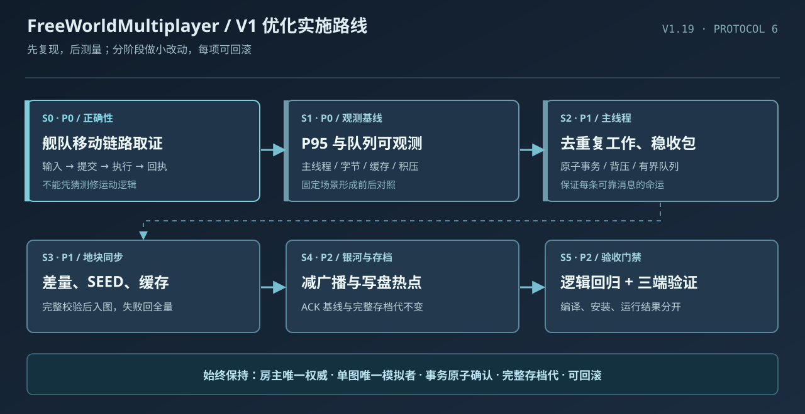

# FreeWorldMultiplayer · 联机插件优化开发案

> 制定：2026-10-16 · 当前基线：V1.19 / 联机协议 6 / 存档结构 1
>
> **状态：执行版（2026-10-16 再核对），未全部完成。** 第一批落地情况见 [实施记录（2026-10-16）](联机优化实施记录-20261016.md)。功能仍以 [联机方案 V1](../联机方案%20V1.md) 为唯一依据，工作区和三端发布约束遵循 [Agent.md](../Agent.md)、[AGENTS.md](../AGENTS.md)。

> **下一阶段执行单：** [联机插件下一阶段优化开发案](联机插件下一阶段优化开发案.md)（源码收口 → 正式构建 → 双端取证 → 定向优化 → 验收）。

> **2026-10-17 的 2D 专项实施案：** [2D 地表、地图加载与联机稳定性优化开发案](联机插件优化开发案-2D稳定性与性能-20261017.md)。包含可认领的 A0/A1/A2、B1～B6、C0 验收方案；具体以该文档任务卡为准，不把已有优化当作未开发功能。

> **本轮最新任务单：** [第五轮：源码闭环、双端实测与热点定向优化](联机插件优化开发案-第五轮闭环与实测-20261017.md)。以 F5-00～F5-06 的实际验收门槛推进，补齐已实现 2D 采样后的发布与运行证据。

> **第六轮执行开发案（2026-10-17）：** [源码闭环、实机取证与有条件的性能优化](联机插件第六轮优化开发案-源码闭环与实机验收-20261017.md)。包含 V6-01～V6-05 五道门禁、实测条件、文件责任、回退与放行标准；未获真实现场证据前不重写同步算法。

> **当前最新优化任务书：** [第七轮：2D 热点实验、舰队正确性和性能验收](联机插件第七轮优化开发案-热点实验与实测验收-20261017.md)。列出 T7-00～T7-06 具体源码入口、先决证据、最小补丁范围、实机指标和回滚条件。

### 当前实施看板（已核实的代码状态）

| 阶段 | 目前已具备 | 距离完成还差什么 |
| --- | --- | --- |
| S0 正确性 | 已提交舰队操作分段日志，能关联 `CommandId`、原生调用、客户端和房主回执 | 尚无新日志证明客户端无法移动的首个断点；未修复并实机验收 |
| S1 基线 | 已实现可关闭的 30 秒耗时直方图与接收队列采样 | 缺少双方同场景游戏数据、命令端到端时延与冷热缓存真实统计；不宣称已有 P95 收益 |
| S2 主线程 | 房主向多客人广播相同消息时已减少重复编码 | 单条大事务、地图加载背压和长帧仍需根据基线选择热点 |
| S3 地图 | 已有 SEED、内容块缓存、差量与损坏回退；第二轮已窄改缓存地图重复 JSON 转换与重组缓冲复制 | 当前优化尚未游戏验收、正式打包或量化收益；三份历史未跟踪地图文件须保留原 Agent 内容后整合 |
| S4 银河/保存 | 已有舰队接收者差量及广播复用 | 还需实测后决定是否优化舰队全扫描或完整代写盘 |
| S5 交付 | 第二轮扩展后 40 项纯逻辑检查通过；静态编译验证沿用各端真实引用 | **尚未正式三端打包/安装/游戏验收**；本机仍未发现构建脚本要求的 PowerShell 7 |

**关键区别**：静态编译、逻辑检查、正式构建、安装和实机联机，是五种不同状态。这里没有已经解决客户端移动、已经降低卡顿 25%、或者已经完成多端上线的结论。本案只规定下一步如何取得证据并完成剩余优化。

## 一、真正要解决什么

**先保证操作正确，再解决卡顿和延迟，最后改善维护成本。** 优化不能牺牲房主权威、玩家独立资产、同图唯一模拟者、事务回执和可靠存档。

1. **可靠**：点击到房主执行、收到回执、画面生效，全链路能定位失败。
2. **流畅**：减少联机主线程长事务、同图操作延迟、切图等待及多人舰队广播成本。
3. **省流量**：避免对已确认的舰队字段、地图内容和个人状态重复编码/传输。
4. **能恢复**：断线、重同步、缓存损坏、失败保存有明确可验证的恢复路径。
5. **好维护**：按 Core / Session / Game / Transport / Entry 小范围拆任务，避免跨层造第二份权威状态。

**不做**：不重写底层联机架构、不改 Project3 本体/共享运行库、不拿压缩和异步当万能药、不降低关键同步可靠性、不修改原 V1 玩法范围。

## 二、已经具备的东西，不要重复开发

| 已读源码/记录 | 已有机制 | 目前仍待实际验证 |
| --- | --- | --- |
| `src/Session/MultiplayerSession.cs` | 收包事务间约 4 ms 预算，最多尝试处理 256 条；单条事务不可被拆断 | 大事务是否导致长帧、消息积压是否加剧操作延迟 |
| `src/Session/SlowOperations.cs`、`SessionPerformance.cs` | 耗时 ≥50 ms 记慢日志；另有可开关的 30 秒分位上界直方图 | 有记录能力，但没有统一场景的实测基线；现有桶值不是精确百分位 |
| `src/Game/NativeMapReplicator.cs`、`Session/MapSnapshotCache.cs` | 地块差量、SEED 方案、内容块缓存、损坏/不一致时回退 | 冷热缓存收益、多人切图及原生地图 ready 的真实表现 |
| `src/Game/NativeFleetSynchronization.cs`、`NativeSharedWorld.cs` | 舰队字段缓存、接收者差量、位姿同步、共享状态缓存及确认基线 | 多玩家字段采样/广播成本、客户端远端显示延迟 |
| `src/Core/Storage.cs` | 完整代、哈希校验、原子指针与上一完整代恢复 | 大世界保存尾延迟及真实崩溃恢复 |
| `AGENT-COORDINATION.md` | V1.16～V1.19 已做同步性能与兼容修复；客户端舰队不能移动的调查尚未确认单一根因 | **缺少输入/提交阶段现场证据，不允许直接猜根因** |

**重要区别**：已有功能 ≠ 通过游戏验收。当前资料中三端编译、安装曾成功，不等于跨机、性能或当前问题已验收。

## 三、按什么顺序做

按 S0 → S1 → S2 → S3 → S4 → S5；S2/S3 在 S1 基线完成后可以分文件并行。每个阶段独立提交、独立验收，失败回退本阶段，不搞一次性大重构。

| 阶段 | 要做的优化任务 | 核心入口（计划中的文件） | 出口标准 |
| --- | --- | --- | --- |
| **S0 · P0 正确性** | 查清并修复客人舰队无法移动；固定链路：原生输入 → FleetCommand 提交 → 传输 → 房主执行 → 回执 → 权威位置/画面 | `GameHooks.cs`、`Game/NativeGalaxy.cs`、`Session/Commands.cs`、`Networking.cs`、`Game/NativeFleetSynchronization.cs` | 主/客舰队移动与拒绝有明确结果；跨星系、暂停、舰战锁、断线恢复不出错 |
| **S1 · P0 测量基线** | 补低开销聚合数据：耗时分位、单条长事务、消息字节、队列峰值、缓存命中、重同步次数 | `Session/SlowOperations.cs`、`MultiplayerSession.cs`、`Transport/TransportQueue.cs`、`docs/` | 同场景能重复得到数字；日志不含身份凭证、聊天、原始资产数据 |
| **S2 · P1 主线程与队列** | 针对 S1 实际热点消除重复解码/拷贝/序列化；保住消息背压、拒绝和关闭通道 | `Session/MultiplayerSession.cs`、`MapViewLoading.cs`、`Authority.cs`、`Transport/` | 长帧明显减少；完整事务不拆半，ACK 不丢，满队列明确失败 |
| **S3 · P1 地块同步** | 优化热图实体/格子差量与内容块复用；验证 SEED 重建、地图 ready 屏障和一次全量回退 | `Game/NativeMapReplicator.cs`、`NativeSeedMapCodec.cs`、`Session/MapSnapshotCache.cs`、`Core/MapCacheStore.cs` | 冷/热/坏缓存切图、加载中退出、跨玩家角色都正确，且网络量或时延下降 |
| **S4 · P2 银河与保存** | 仅在 S1 确认热点后复用舰队采样/广播结果、减少重复字段遍历；或优化完整存档捕获/IO 边界 | `Game/NativeFleetSynchronization.cs`、`NativeSharedWorld.cs`、`Session/MultiplayerSession.cs`、`Core/Storage.cs` | 仍保持接收者确认基线、完整存档代、一次结算、离线冻结；有量化收益 |
| **S5 · P2 交付与维护** | 纯逻辑回归样例，三端独立编译/安装/运行验收证据；只做必要的局部类拆分和 UI 状态一致性 | `Core/Protocol.cs`、`Session/`、`Entry/`、构建和同步脚本 | 构建、包、安装、游戏运行分别记账；出问题能精准回滚 |

### S0：舰队移动问题先取证再修

给同一条命令贯穿记录 `CommandId`、`FleetUid`、固定阶段和成功/拒绝原因：**原生点击/目标选择 → Hook → Submit → Send → 房主 ExecuteHostCommand → ExecuteFleetCommand → 完成回执 → 房主位姿 → 客户端表现**。

- 未发生命令提交：查输入拦截、命令 Hook 与画面门禁；已提交未到房主：查通道与队列；房主确认但没位移：再查原生运动和同步表现。
- 仅记录必要编号/阶段，不记录凭证、昵称、聊天正文、网络原始 payload；采样有上限，不能逐帧写盘。
- 目前缺少可证明的根因，因此**不要为了修卡顿先改移动时间推进、网络发包频率或接收预算**。

### S1：统一的测量方法

固定硬件、地图、人数、MOD 源码指纹及网络条件；房主与客人均采样。至少覆盖双人联机，条件允许时覆盖 3～4 人；每个场景重复至少 3 次，记录中位数、P95 与最大值。

**标准场景**：新建/续开 → 加入 → 同星系航行 → 冷图首次加载 → 热图再次加载 → 同图建筑/雇员操作 → 跨图 → 存档/退出 → 断线重连；Steam / TapTap / IP 直连分别覆盖可用路径。

**记录维度**：主线程单事务耗时 P50/P95/P99 与最大值、按消息类型的大小/次数、发送接收队列峰值/最长等待、入图耗时、缓存命中与全量回退数、用户命令到回执时延、保存耗时。现在已有可选 `FWM_PROFILE=1` / `-fwm-profile` 的阶段直方桶，需按 [复测手册](联机优化复测手册.md) 实际采集；消息类型、端到端时延、冷热缓存命中等**尚未由现有聚合器完整覆盖**，应先评估最小补充指标，而非虚报已测到。

### S2～S4：具体优化原则

1. **先减重复工作**，例如相同基线重复编码、同一帧重复读取反射字段、对未变化地图执行完整序列化；任何缓存都要明确何时失效。
2. **再处理长事务**。当前 4 ms 只限制事务之间；不能将已经开始的原生事务跨帧执行成半提交。若耗时集中在入图或保存，明确“可准备”与“正式应用”的边界。
3. **最后考虑调频率/压缩**。频率降低可能让操作延迟更大，压缩本身可能增加主线程负荷。须先拿 S1 数据比较收益。
4. 保持 `AuthorityEpoch + Revision + CommitId`、个人 Revision、银河序号、ACK、一次性赠送/袭击/舰战结算不变；错误重同步必须有界，不把权威消息静默丢弃。
5. 地图缓存是**派生数据**：校验错误要向房主重新获取；SEED 不能替代人员、物资、建筑或实际存档。完整存档不能依赖客端缓存才能读回。

## 四、可量化的验收门槛

以下是**建议目标，须在 S1 测出基线后确认**，不是现有成绩。采用相同场景/人数/环境的前后对照；同场景至少 3 轮。

| 对象 | 暂定性能目标 | 绝对不能回归 |
| --- | --- | --- |
| S0 舰队 | 命令到结果有明确记录，用户不再“无反应” | 房主/客人正常移动；暂停/锁定拒绝；不复制舰队 |
| S2 卡顿 | 选中热点的 P95 下降 **≥25%**，其他关键路径 P95 退化 **≤10%** | 不丢可靠消息、不产生半事务、不绕开背压 |
| S3 地块 | 热图传输总字节或入图 P95 下降 **≥25%**，另一项不明显恶化 | 地形/角色/库存一致；坏缓存可完整回退 |
| S4 银河 | 选定广播热点 CPU 或每玩家字节数下降 **≥20%** | 在线全舰队互见、离线冻结、增量序号连续 |
| S4 存档 | 若保存确为热点，其 P95 下降 **≥20%** | 一次性结算不重复；指针/哈希/完整代/旧代恢复正确 |
| 全程 | 无新增严重故障，观察队列、内存与重同步随时间的趋势 | 验收样例中 0 次资产重复、确认后丢失、非法双模拟或旧任期覆盖 |

如果收益不足、尾延迟显著恶化或无法证明事务正确，**撤回该项优化**。不能用“编译通过”冒充性能与游戏验收。

## 五、最小回归矩阵

| 场景 | 必须检查的游戏行为 | 主要证据 |
| --- | --- | --- |
| 单机 ↔ 联机 | 存档、身份与世界隔离 | 目录对照、原生存档列表 |
| 2～4 人首次加入/重连/重复登录 | 玩家资产、UID 不合并、不重复发放 | 玩家/舰队/雇员身份与权威记录 |
| 同星系/跨星系舰队移动、离线冻结 | 客人可控制己方舰队，远端互见；断线不补航程/燃油 | 命令 ID、原生位姿和重连快照 |
| 冷图、热图、坏缓存、入图时退出 | 只应用已就绪地图事务，顺序保持；必要时全量回退 | 地图修订、hash、队列与加载栅栏 |
| 地表合作、关系变更、模拟者断线接管 | 单图仅一台电脑模拟，人物物资同步、不双算 | `AuthorityEpoch`、地块/个人 Revision |
| 赠送、袭击、玩家舰战 | 防重复结算、真实战果、倒地保护、唯一撤离 | 事务 ID、存档代、双方资产 |
| 保存失败、杀进程、房主退出 | 旧完整代可读，未确认不宣称落盘，客人安全退出 | `active.json` / 上一代 / 哈希 / 日志 |
| Project3、Steam、TapTap | 各自引用正确；只部署本 MOD；运行效果由用户验收 | `BUILD-INFO.json`、同步回执、游戏日志 |

建议新增纯逻辑测试：协议长度/版本拒绝、消息顺序及容量边界、重复命令与修订校验、原子存档/上一代恢复、缓存损坏回退。**这些测试不能替代 Unity 原生行为和跨机实测**。

## 六、如何按 Agent 协作实施

- **主控**：分配文件所有权、约定接口、交叉审查、合并、三端构建与发布回执。具体功能交给 Game、Session/Core、Transport、Entry 分工的子 Agent。
- **Game** 只负责原生捕获/应用/表现；**Session/Core** 负责权威事务与保存；**Transport** 只处理字节队列、断开及重试；**Entry** 只展示真实业务结果。跨模块契约变化先在 [AGENT-COORDINATION.md](../AGENT-COORDINATION.md) 登记，再动代码。
- 每个小任务需保存：复现、修改前数据、最小差异、修改后数据、正确性回归、三端编译/安装/运行的各自状态、回滚办法。提交仅包含本任务修改，保留其他 Agent 及用户未提交内容，未经授权不 push。
- **仅修文档不升版本**。真实 BUG 修复按仓库规定更新 `VERSION`、`CHANGELOG.md`；只有确实修改了协议/存档契约才评估版本升级，不能为优化而无条件升级。
- 三端由主仓库 `Sync-ModCopies.ps1` 分别针对真实依赖构建；若目标运行中、签名不兼容、队列/数据正确性未通过，停止安装，不强制结束游戏，不替换本体或共享 Harmony。

## 七、下一轮可直接分配的开发任务

以下任务相互独立，**不是要求一次性同时修改**。顺序以解除阻塞和保护存档为先：G0 → F1 → M1；之后根据 M1 的具体耗时分布，择优执行 O1、O2、O3，不按推测同时开工。

| ID / 优先级 | 负责范围（开始前确认文件占用） | 输入和具体动作 | 完成证据 |
| --- | --- | --- | --- |
| **G0 / P0 构建门禁** | 主控、`build.ps1`、`Sync-ModCopies.ps1` | 确认 PowerShell 7 和三端真实引用可用；保护所有既有未提交修改；先用 `-BuildOnly`，禁止用静态编译 DLL 假冒发布包 | 每端包内 `BUILD-INFO.json` 目标正确，`SourceRevision` 一致；安装前检查目标游戏运行状态与共享依赖 |
| **F1 / P0 舰队移动现场诊断** | Game 航行 Hook + Session 命令链接口负责人 | 双端**同一条**航行操作，读取双方 `[fleet-command]` 日志，按 `native.hook → native.route → session.submit → client.sent → host.received → host.native.begin/end → host.result → client.result` 定位断点；只修实证失败处 | 客人/房主航行和暂停、舰战锁、跨星系及断线恢复的真实结果一致；拒绝显示明确原因，保留日志证据 |
| **M1 / P0 性能基线** | Session/Transport 观测负责人 | 双人、可选三到四人，固定地图与网络；分别做冷图、热图、同图生产、银河移动、保存与重连，每种至少 3 次；记录 `[profile]` 与用户感知时长 | 阶段耗时 P50/P95/P99（标记为桶上界）、最大值、接收队列峰值、入图耗时、网络字节及对照环境；列出前 3 个实际热点 |
| **O1 / P1 主线程** | Session/Transport 各自独占文件 | 仅对 M1 确认的大头消除重复解码/捕获、复制与分配；区分单条事务长帧和队列积压 | 同场景前后 P95 改善、尾延迟不显著变坏；ACK/重连/终止 FIFO、错误满队列和事务原子性不回归 |
| **O2 / P1 地图** | Game 地图 + Session 缓存 + Core 内容存储，先约定跨模块契约 | 只有 M1 表明地图是主要热点才动；比较冷图/热图发送字节、缓存命中和原生 ready；针对重复捕获做可失效的局部复用 | 缓存命中真实省流量；失配可回全量、人物/建筑/物资完整、任期和序号正确、失败不双应用 |
| **O3 / P2 银河/保存** | Game 舰队同步或 Core 保存，**分别**定责 | 分别判断是按玩家多次字段编码还是完整保存捕获/IO 占主导；只选测得的热点 | 同星系所有在线舰队可见、断线冻结；同代存档哈希、上一完整代恢复和战果唯一结算保持不变 |
| **R1 / P0 交付验收** | 主控整合 + 用户执行实际游戏回归 | 检查纯逻辑、P3/Steam/TapTap 三种正式构建和安装回执；用户实际加载后测试两端航行、切图、重连、退出、杀进程恢复 | 明确五栏状态：代码／编译／打包／安装／游戏内验收；任一不通过不宣称全案完成 |

### 每张任务卡统一交付要求

- **改前**：复现步骤、日志证据、对应源文件和基线数据；跨文件前在 `AGENT-COORDINATION.md` 预约并释放占用。
- **实施**：最小差异，不伪造 ACK、不更改玩法、不让客人重算世界、不跳过完整代保存；若涉及协议/存档契约则额外评估兼容版本。
- **改后**：源码指纹、独立 Git 提交、相同环境前后对照、回归结果与回滚点。原有混合未提交改动不能夹带暂存或覆盖，未授权不 push。
- **放行**：满足第四节的建议性能指标，并且第五节的资产和恢复门槛没有退化；仅有静态编译成功不能通过性能放行。

**下一步优先执行 G0 的正式只构建门禁，同时安排 F1 的客端/房主同一命令取证。** 若双端复现条件尚不具备，先完成构建和测量脚本准备，不以猜测代码替代现场证据。

> 本方案起初仅为设计文档，已有第一批代码见 [实施记录](联机优化实施记录-20261016.md)；**不以代码编译通过代替性能基线、舰队故障修复或游戏验收。**
