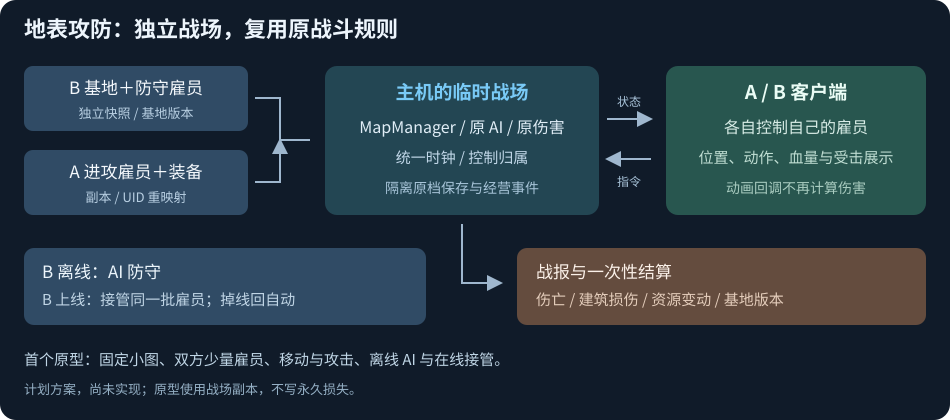

# 地表联机：源码接入方案

> **历史参考，已由 [联机方案 V1](联机方案%20V1.md) 取代（2026-10-15）。** 下文的临时战场、本体适配、房主整场模拟和分期安排仅保留作历史线索。当前采用 V1 的获授权客户端模拟、完整保存、保证倒地及限时单次撤离规则。

> 2026-10-14｜静态源码评估；模块与接口为计划新增，未修改游戏逻辑、编译或运行测试。

**采用“B 基地快照＋A 进攻雇员副本 → 临时战场 → 主机完整模拟 → 客户端展示 → 一次性结算”。** 沿用总方案的 Steam 网络层；地表主要需要本体适配地图、角色与保存边界。

## 具体怎么做

| 计划模块 | 接入职责 |
| --- | --- |
| `GroundSnapshotExporter` | 导出 B 的地形、建筑、防御、电力、物品及本图防守雇员；携带基地版本和配置版本。A 导出参战雇员、装备与携带物 |
| `GroundSessionScope` | 保存原世界/存档绑定，进入独立临时数据；隔离原档保存、任务与世界事件；结束后恢复原会话 |
| `NativeGroundBridge` | 复用 MapManager、寻路、AI、伤害与建筑逻辑；增加主机模拟/客户端副本模式及统一战场时钟 |
| `GroundCommandGateway` | 框选与指令按玩家归属处理；主机验权限、目标和序号后调用原 RoleCommand；区分接受、排队与拒绝 |
| `GroundReplicaView` | 应用位置、朝向、动作、血量、部位伤势与装备状态；只播放视觉事件，不计算伤害或掉落 |
| `GroundResultService` | 抽取伤亡、建筑损伤与物资变动；按战斗 ID、原实体映射和基地版本只结算一次 |

## 双方怎么控制雇员

- 主机可固定 B 为防守方、A 为进攻方，接现有建筑敌友规则；**玩家归属、战场阵营、雇员类型分别记录**。
- 当前 MINE/ENEMY 会影响角色生理与日常 AI。新增 `PlayerEmployee` 装配分支，让两边仍保留雇员属性，不能把 A 的雇员直接装配成普通敌人。
- 客户端只框选自己 owner 的单位，攻击目标按战场阵营判断；不随客户端视角翻转正式 Bean 阵营。
- 征召、移动、攻击继续调用现有 `AI_FightCharacter/RoleCommand`。输入层先发送意图，唤醒角色、清占用等副作用也留到主机执行。

## 离线防守与在线接管

**B 离线**：由 A 主机或专用 Unity 战场进程载入已发布快照，真正运行防守 AI；战后保存战报。现有离线生产补算不能当作攻防模拟。

**B 在线/中途上线**：加入同一个战斗 ID，取得当前完整状态，再接管原有防守雇员；不重新导入一套角色。接管、掉线回自动与旧指令失效由主机在控制权转换边界处理。

原型可使用好友主机；正式资源争夺需要服务器管理参战资产与可信结果。基地快照发布后，不能靠重新上传旧存档撤销损失。

## 源码里的关键难点

- **快照要完整且独立**：[地图角色加载](C:/Users/CatStudio/Desktop/Project3/Assets/Script/FairyZGame/FairyGame/MapManager/MapManager.cs:586) 从 `gameData.heros` 取己方雇员，外来角色才在 `thirdRoles`。只复制地图会漏人；地形又有共享引用复制标记，需要明确复制/序列化边界。导入角色、装备及关联 UID 统一重映射，再复用 `addStarMapRole/HeroManager`。
- **客户端从加载就禁止模拟**：[地图初始化](C:/Users/CatStudio/Desktop/Project3/Assets/Script/FairyZGame/FairyGame/MapManager/MapManager.cs:1106) 会预跑 200 次逻辑；后续地图循环还驱动建筑、角色、物品、天气和弹丸。副本模式必须覆盖初始化与持续更新。
- **动画也会写业务**：[HeroAnim](C:/Users/CatStudio/Desktop/Project3/Assets/Script/FairyZGame/FairyGame/Role/RoleHero/HeroAnim.cs:183) 的攻击回调直接造成伤害，完成回调还改攻击状态。需要 `Authority/Replica` 初始化分支与独立 `AdvancePresentation`，不能只禁 AI、保留原动画回调。
- **伤亡与破坏只能在战场数据中发生**：[角色死亡](C:/Users/CatStudio/Desktop/Project3/Assets/Script/FairyZGame/FairyGame/Role/BaseRole/BaseRole.cs:909) 会清背包、写死亡、推进任务；建筑摧毁还可能生成重建蓝图。客户端仅应用结果展示，不能重复调用这些入口。
- **不能直接换 UserBean 就算隔离**：[useGameData](C:/Users/CatStudio/Desktop/Project3/Assets/Script/FairyZGame/FairyCore/User/UserBean.cs:238) 还会初始化银河事件与恢复交易。临时 scope 要覆盖在途保存、自动/手动保存和原档目标；结束只合并约定结果，不覆盖整份存档。

## 首个地表原型

**固定小地图，A/B 各 2–3 名普通雇员：移动、攻击、倒地/死亡展示 → B 自动防守 → B 在线接管与掉线回自动。**

先不开放建造、生产、搬运、俘虏与永久损失；然后接基地快照、炮塔/建筑破坏及正式结算。扩大到真实基地时，电力、防御和门等战斗依赖必须继续运行，不能一并关闭所有建筑逻辑。

地表难度高于星系互见，主要工作是副本展示与临时世界隔离；不建议首版做双方确定性锁步或直接同步整个经营世界。

参考：[Supercell 2019 年基地快照说明](https://supercell.com/en/games/clashofclans/blog/news/faq-legend-league-redesign/)。在线亲自接管防守是本构想新增的玩法，以上接入方式尚待实现与用户运行验收。
