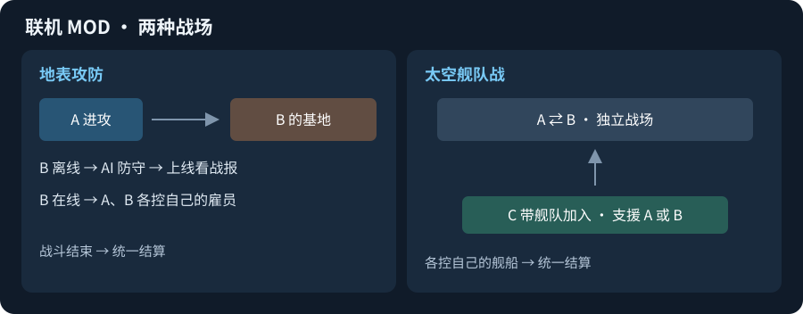

# 联机 MOD 基础构想

> **历史草案，已由 [联机方案 V1](联机方案%20V1.md) 取代（2026-10-15）。** 下文旧玩法与配图仅供回顾；不按其拆分交付或新增太空舰战、第三方支援。

> 2026-10-14｜玩法草案；[源码难度评估与框架建议](联机MOD源码评估.md)已记录，联机功能尚未实现。

## 地表：离线防守，在线共同战斗

- 玩家 A 攻击玩家 B 的基地。
- **B 离线**：按保存的基地、雇员和防守部署，由 AI 防守；结束后保存战报，B 上线查看结算。
- **B 在线**：双方进入同一地表战场，A 控制自己的进攻雇员，B 控制自己的防守雇员。
- 建议 B 可在战斗中途接管，未接管或掉线时由 AI 继续；结束后统一结算胜负、资源和伤亡。

## 太空：独立战场，第三方选边

- A 攻击 B 的舰队，生成独立的战场交互区。
- 玩家 C 可以带自己的舰队加入，选择支援 A 同盟或 B 同盟，各自控制自己的舰船。
- 建议限制援军人数和入场时间，同一场战斗禁止换边；结束后统一结算各方损失与收益。

## 建议与待定

- **先做小版本**：地表双人攻防 → 离线防守结算 → 太空第三方支援。
- **建议统一规则**：联机战斗使用统一速度；离线防守设损失上限和保护期；结算只写回一次。
- **需要后续确定**：胜负条件、雇员是否永久死亡、基地破坏如何恢复、太空 B 离线怎么办。
- 离线防守需要持续可用的基地与战报存储；不能依赖 B 的游戏一直开着。

参考：[Supercell 2019 年传奇联赛说明](https://supercell.com/en/games/clashofclans/blog/news/faq-legend-league-redesign/)中的基地快照思路；在线接管防守是本构想新增的玩法。
