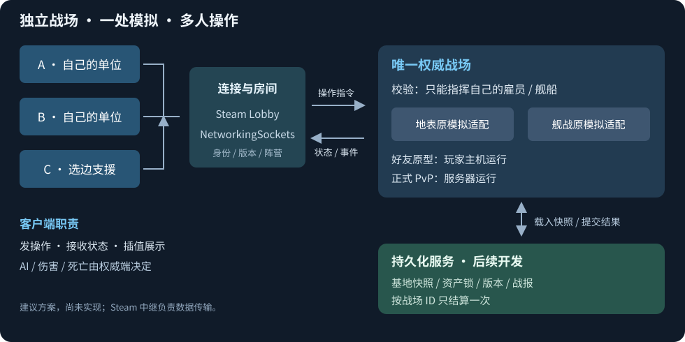

# 联机 MOD：源码评估与框架建议

> **历史评估，现行需求以 [联机方案 V1](联机方案%20V1.md) 为准（2026-10-15）。** 源码位置仍可作为查阅线索；旧交付顺序、本体适配建议及太空交易、舰战内容不属于当前执行依据。完整 V1 尚未正式开工。

> 2026-10-14｜依据 Project3 当前源码的静态评估；未运行游戏、测试或编译。Steam 发行版 API 兼容性尚未逐项核对。

**可以做，但属于系统级扩展。建议采用“独立战场＋单一权威模拟＋状态同步”，先做好友战场，再做离线攻防与正式结算。**

## 难度判断

| 范围 | 难度 | 主要原因 |
| --- | --- | --- |
| 基地快照＋AI 防守＋战报 | 中高 | 有地图/存档数据，但没有现成离线攻防结算 |
| 地表在线各控自己的雇员 | 高 | 指令、AI、伤害、建筑与模拟都在本机执行 |
| 太空双人及三人开战前选边 | 高 | 已有多参战舰队基础，缺玩家归属与实时同步 |
| C 战斗中途加入／掉线重连 | 高 | 要补参与者注册、完整快照、增量衔接和部署配额 |
| 正式资源损失、多账户结算与多房间服务 | 很高 | 单存档、单战场依赖；需要服务端资产与事务 |

这是按现有改造范围判断的相对难度，不能据此承诺工期。

## 源码已经具备什么

- **网络底层有，实时联机未接好**：[NetSender.cs:2165](C:/Users/CatStudio/Desktop/Project3/Assets/Script/FreeWorldNet/Net/NetSender.cs:2165) 的舰战同步发送被注释；旧同步 DTO 自身也标“废弃”。现有 TCP 请求/响应不能直接当多人战场框架。
- **地表命令可复用**：[RoleCommand.cs:433](C:/Users/CatStudio/Desktop/Project3/Assets/Script/FairyZGame/FairyCore/CoreAgent/RoleCommand.cs:433) 已有移动/攻击入口，但直接修改本地 AI；[MapManager.cs:1623](C:/Users/CatStudio/Desktop/Project3/Assets/Script/FairyZGame/FairyGame/MapManager/MapManager.cs:1623) 用本地时间跑整张地图，加载时还预跑逻辑。
- **舰战多方结构较好**：[BattleParticipant.cs:27](C:/Users/CatStudio/Desktop/Project3/Assets/Script/GalaxyBattle/Battle/BattleParticipant.cs:27) 已有参与者、来源舰队、队伍和快照；但控制权只区分“玩家方”，没有玩家 owner。现有增援只支持已登记舰队，[AddParticipant:215](C:/Users/CatStudio/Desktop/Project3/Assets/Script/GalaxyBattle/Battle/BattleReinforcementCoordinator.cs:215) 在初始化后拒绝新参与者。
- **数据与存档可复用，隔离要补**：[UserBean.cs:35](C:/Users/CatStudio/Desktop/Project3/Assets/Script/FairyZGame/FairyCore/User/UserBean.cs:35) 是单例，只有一份当前数据；[Archive.cs:2491](C:/Users/CatStudio/Desktop/Project3/Assets/Script/FairyZGame/FairyCore/Archive/Archive.cs:2491) 已有快照机制，但不是战场专用快照接口。
- **云存档与 MOD 入口已有**：[云上传:191](C:/Users/CatStudio/Desktop/Project3/Assets/Script/FairyZGame/CloudArchive/BackendCloudArchiveApi.cs:191) 有版本检查与请求去重，仍是存档上传；[MOD 加载:217](C:/Users/CatStudio/Desktop/Project3/Assets/Script/FairyZGame/FairyCore/ModPlugin/ModPluginManager.cs:217) 能加载 C# DLL。这些可以接入，但不能代替多人模拟和跨账户结算。

## 建议怎样搭框架

1. **连接与房间**：Steam 版优先复用已存在的 Steamworks.NET，使用 Lobby＋`SteamNetworkingSockets`。另定义传输接口，未来可以接专用战场服务器。握手核对游戏、MOD 和配置版本；收包后回 Unity 主线程处理。[Steam 官方网络说明](https://partner.steamgames.com/doc/features/multiplayer/networking)
2. **战场会话**：保存战场 ID、玩家 ID、阵营、单位归属和快照版本。`OwnerPlayerId` 与阵营分开；主机统一分配战场实体 ID，并记录“原玩家＋原 UID”映射，避免两份存档 UID 冲突。
3. **玩法适配**：地表接 `RoleCommand/MapManager`，太空接战术命令、现有参与者与伤害组件。仅权威端跑 AI、移动、命中、死亡与胜负；客户端发送操作，接收位置/状态快照和开火/死亡等事件，插值显示。归属由权威端校验，不能只过滤 UI。
4. **快照与结算**：加入/重连先收完整战场，再衔接后续增量；C 入场走正式注册、配额与部署流程。服务器按战场 ID、资产版本和玩家归属一次性结算，锁定参战单位与可扣资源，避免重复奖励和旧结果覆盖新存档。

**先不采用命令锁步**：当前本地时间、随机和舰战 Unity 物理都需要大量确定性改造。也不能只给角色挂一个网络坐标组件；客户端仍可能自行扣血、死亡或生产。

## MOD 边界与推进顺序

- **纯外部 MOD**：可尝试用 Harmony 接入，侵入本体文件少，但要覆盖初始化、模拟、权限和保存等多个入口，版本维护成本高。
- **更适合长期维护**：本体开放稳定的战场加载/退出、权威模拟、命令、快照、归属和结算接口；联机 MOD 负责房间、协议与适配。这是建议，尚未修改本体。
- **首个原型建议**：太空两人固定小舰队，只做战术移动/攻击，不产生永久损失 → 三人开战前选边 → 地表双人小地图 → 离线基地快照 → 中途加入、重连与正式结算。舰战已有多参与者基础，因此相比初稿更适合先试这一块。
- **离线防守的条件**：好友玩法可以由 A 主机运行 B 的已上传快照，B 上线后接管同一战场；正式竞争玩法需要服务器管理参战资产并运行战斗。Steam 中继只转发数据，不负责防守 AI 或可信结算。
- **服务端的条件**：先按一个 Unity 进程一个战场考虑。当前模拟依赖场景、单例与物理，不能直接搬到普通 .NET 服务；多房间与无图形运行需要后续拆分。

网络参考：[Steam Datagram Relay](https://partner.steamgames.com/doc/features/multiplayer/steamdatagramrelay)、[Unity Netcode](https://docs.unity.com/en-us/multiplayer/netcode/netcode)。它们提供网络能力，游戏中的控制权、模拟和结算仍需适配。
